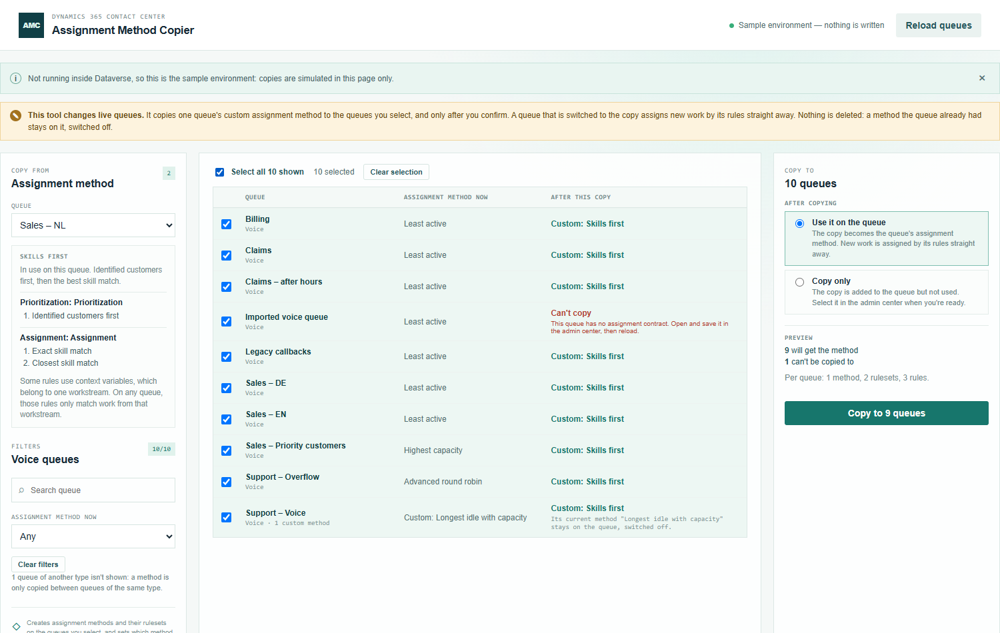

# Assignment Method Copier

Part of the [Promethean CCaaS Toolbox](../../Readme.md). A **provisioning tool**: it copies the custom assignment method of one advanced queue to many other queues at once. Build the method once in the admin center, then pick the queues, check the preview and confirm.

A custom assignment method belongs to one queue, and the platform has no shared or template methods, so the admin center makes you rebuild the rules on every queue. [Queue Builder](../queue-builder/README.md) creates queues with one of the three built-in methods; this tool is how a custom method gets onto them.

> **Tested live in one environment so far** (copy only, copy and use, editing a copy). Routing through a copied method and **Switch queues back** haven't been tested live; see [IMPLEMENTATION_STATUS.md](IMPLEMENTATION_STATUS.md#live-findings-2026-10-13). In a new environment, start with **Copy only** on one test queue.

See the [manual](manual.md) for a walkthrough with screenshots.



## How it works

1. **Choose the method.** Pick the queue to copy from; only queues that hold a custom method are offered. If the queue holds several, pick one. Its rulesets and rules are shown so you can see what will be copied.
2. **Select queues.** Every other advanced queue of the same type is listed with the assignment method it uses now. Filter by text or current method, then tick queues one by one or **Select all shown**. Selection survives filtering.
3. **Choose what happens after copying.**
   - **Use it on the queue**: the copy becomes the queue's assignment method. New work is assigned by its rules straight away.
   - **Copy only**: the copy is added to the queue but not used, to select in the admin center later.
4. **Preview.** Each selected row shows what its assignment method would become, or why the method can't be copied to it.
5. **Copy.** After a confirmation naming the environment, each queue gets the method (switched off), then each ruleset and its step, and only then is the queue switched. Every copy is read back.
6. **Review, log and switch back.** The result shows what was copied and what failed and why. **Download log** saves the run. **Switch queues back** puts every switched queue back on the method it used before.

## What a copy contains

| Record | Copied as |
| --- | --- |
| The method (`msdyn_assignmentconfiguration`) | Same name and description, on the target queue. If the queue already has a method with that name, the copy is named "Name (2)". |
| Each ruleset (`msdyn_decisionruleset`) | Same name, rules and settings. Its contracts point at the **target** queue's assignment contract where the source pointed at its own queue's. Every rule gets a new id. |
| Each step (`msdyn_assignmentconfigurationstep`) | Same kind (prioritization or assignment) and order. |

Rules are copied as they are. Conditions on skills, presence, capacity, schedule, language and region work on any queue. Two things to know:

- **Context variables** belong to one workstream. A rule that uses one only matches work that came in through that workstream, on whichever queue it runs. The tool says so when the method has such rules.
- A value that is a record id (for example a specific account) is copied unchanged.

## When a queue or method can't be copied

| Situation | What happens |
| --- | --- |
| The queue is of another type than the source (voice, messaging, record) | Not listed. |
| The queue has no assignment contract | Blocked. Open and save the queue in the admin center, then reload. |
| The method has no rulesets | Nothing can be copied. Add its rules in the admin center first. |
| A ruleset is model-based or uses a component | Nothing can be copied; only rule-based rulesets are supported. |
| A rule refers to the source queue itself | Nothing can be copied; it wouldn't work on another queue as it is. |

The platform's own `<CDS System>` queues are never listed.

## Failures

- One queue failing doesn't stop the others.
- A copy that stops part-way never switches its queue. The unfinished method stays on the queue, switched off; delete it in the admin center.
- A copy that saved but reads back differently is reported as **Done, not confirmed**.

## Run log

**Download log** saves `assignment-method-copy-log-<date><time>.csv` (or `assignment-method-switch-back-log-…`), one row per queue: the tool, environment, user, run start and finish time, action, the method and queue copied from, queue, queue id, status, the copy's name and id, the method the queue used before, whether the copy is in use, every record created, the time and any error.

## Permissions and safety

The person using it is expected to be a **system administrator** (or have create access to the three tables below and write access to `queue`).

- **Creates**: `msdyn_assignmentconfiguration`, `msdyn_assignmentconfigurationstep`, `msdyn_decisionruleset`.
- **Updates**: `msdyn_isactiveconfiguration` on `msdyn_assignmentconfiguration`, and `msdyn_assignmentstrategy` on `queue`. No other column of a queue is written.
- **Never deletes**, and never writes a decision contract. A method a queue already had stays on it, switched off.
- All writes are in `src/dataverse.ts`, which refuses any table or column outside `CREATE_COLUMNS` and `UPDATE_COLUMNS` in `src/schema.ts`. They go straight to the Web API as POST and PATCH requests, because `Xrm.WebApi.createRecord` refuses these tables. `tests/writeScope.test.ts` pins the column lists and fails if a delete, `execute` or an `Xrm.WebApi` write appears in `src/`, or if the Web API is called from another file.
- Switching a queue changes how its work is assigned from that moment. Copy outside busy hours, or use **Copy only** and switch in the admin center.

## Tables read

`queue` (active advanced queues, their type, method and assignment contract), `msdyn_assignmentconfiguration`, `msdyn_assignmentconfigurationstep`, `msdyn_decisionruleset`.

## Build, run, deploy

```powershell
npm install
npm test
npm run demo:assignmentmethodcopier   # http://localhost:5445/index.html — sample environment, nothing is written
pwsh ./scripts/deploy.ps1 -Tool assignmentmethodcopier -CreateIfMissing   # first time
pwsh ./scripts/deploy.ps1 -Tool assignmentmethodcopier                    # afterwards
```

Web resources: `pct_/tools/assignmentmethodcopier/{index.html,style.css,bundle.js}`. The tool isn't in the packaged solution or the app's Site Map yet; after deploying, add a subarea for `pct_/tools/assignmentmethodcopier/index.html` (see the [toolbox README](../../Readme.md#site-map-subareas)).
