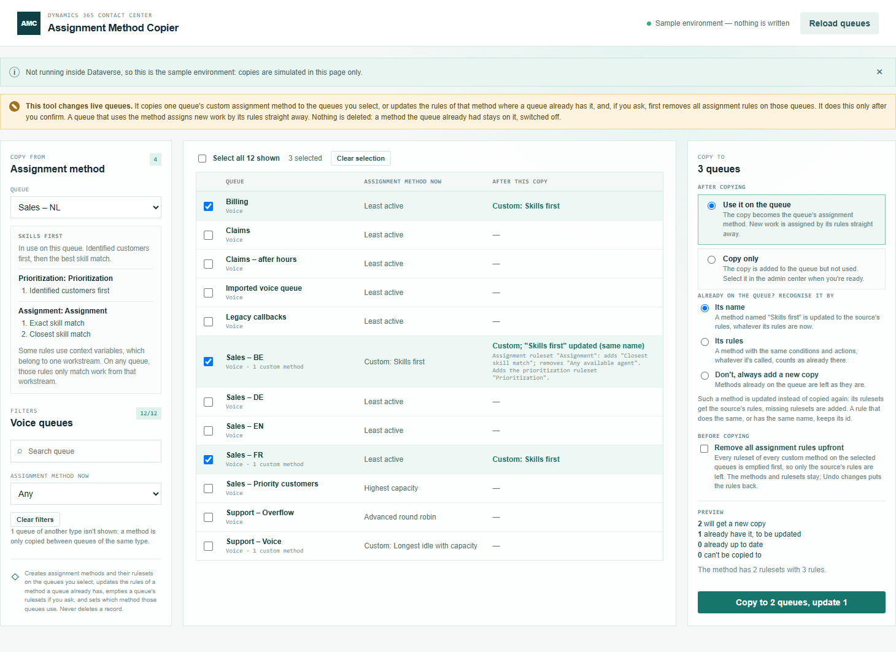
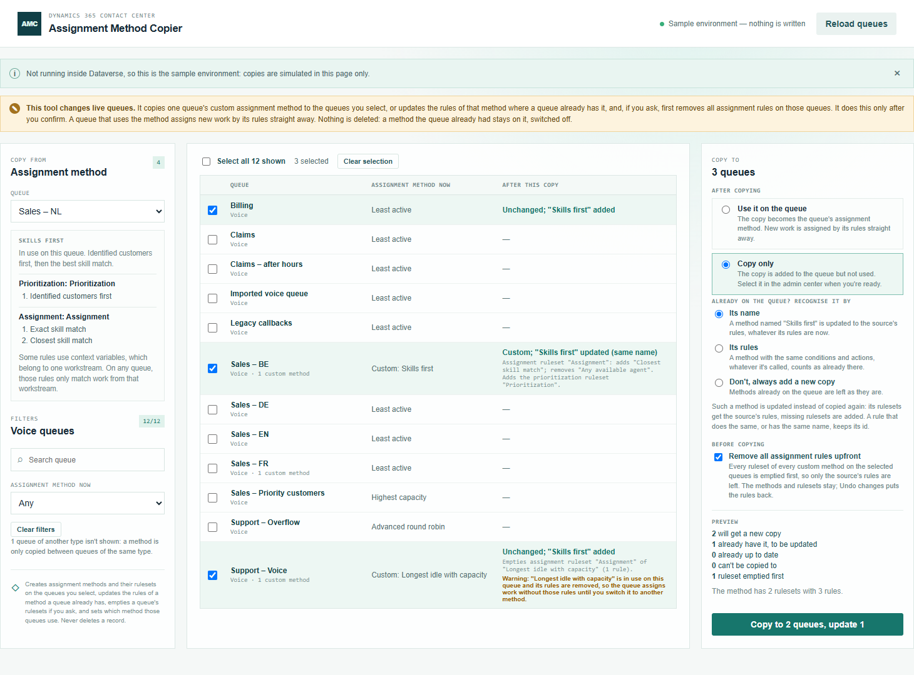

# Assignment Method Copier

Part of the [Promethean CCaaS Toolbox](../../Readme.md). A **provisioning tool**: it copies the custom assignment method of one advanced queue to many other queues at once. Build the method once in the admin center, then pick the queues, check the preview and confirm. Where a queue already has the method, the tool updates its rules to match instead of adding a second copy.

A custom assignment method belongs to one queue, and the platform has no shared or template methods, so the admin center makes you rebuild the rules on every queue. [Queue Builder](../queue-builder/README.md) creates queues with one of the three built-in methods; this tool is how a custom method gets onto them, and how a change to it reaches them all.

> **Tested live in one environment so far** (copy only, copy and use, switch back, editing a copy). Routing a conversation through a copied method hasn't been tested live, and neither has **updating** a method already on a queue (added 2026-11-19); see [IMPLEMENTATION_STATUS.md](IMPLEMENTATION_STATUS.md). In a new environment, start with **Copy only** on one test queue.

See the [manual](manual.md) for a walkthrough with screenshots.



## How it works

1. **Choose the method.** Pick the queue to copy from; only queues that hold a custom method are offered. If the queue holds several, pick one. Its rulesets and rules are shown so you can see what will be copied.
2. **Select queues.** Every other advanced queue of the same type is listed with the assignment method it uses now. Filter by text or current method, then tick queues one by one or **Select all shown**. Selection survives filtering.
3. **Choose what happens after copying.**
   - **Use it on the queue**: the method becomes the queue's assignment method. New work is assigned by its rules straight away.
   - **Copy only**: the copy is added to the queue but not used, to select in the admin center later.
4. **Choose how a method already on the queue is recognised** (**Already on the queue**, both on by default):
   - **A method with the same rules**: rules with the same conditions and actions, whatever the method is called.
   - **A method with the same name**: whatever its rules are now.

   With both off, every queue gets a new copy, as before.

   **Before copying**, **Remove all assignment rules upfront** (off by default) empties every ruleset of every custom method on the selected queues first, so only the source's rules are left. See [Removing all rules first](#removing-all-rules-first).
5. **Preview.** Each selected row shows what its assignment method would become: a new copy, an update (with the rules it adds, changes and removes), already up to date, or why it can't be copied.
6. **Copy.** After a confirmation naming the environment, each queue gets the method (switched off), then each ruleset and its step, and only then is the queue switched. An update rewrites the existing method's rulesets first. Every result is read back.
7. **Review, log and undo.** The result shows what was copied, updated and what failed and why. **Download log** saves the run. **Undo changes** puts every switched queue back on the method it used before, and every updated ruleset back to its old rules.

## What a copy contains

| Record | Copied as |
| --- | --- |
| The method (`msdyn_assignmentconfiguration`) | Same name and description, on the target queue. If the queue already has a method with that name (and **same name** is off), the copy is named "Name (2)". |
| Each ruleset (`msdyn_decisionruleset`) | Same name, rules and settings. Its contracts point at the **target** queue's assignment contract where the source pointed at its own queue's. Every rule gets a new id. |
| Each step (`msdyn_assignmentconfigurationstep`) | Same kind (prioritization or assignment) and order. |

Rules are copied as they are. Conditions on skills, presence, capacity, schedule, language and region work on any queue. Two things to know:

- **Context variables** belong to one workstream. A rule that uses one only matches work that came in through that workstream, on whichever queue it runs. The tool says so when the method has such rules.
- A value that is a record id (for example a specific account) is copied unchanged.

## When the queue already has the method

A method on the target queue counts as the source method when it has **the same rules** (checked first) or **the same name**, as chosen in step 4. It is then updated instead of copied again:

| Part | What happens |
| --- | --- |
| A ruleset of a kind both have (prioritization, assignment) | Its rules become the source's, in the source's order. A rule that does the same as one already there keeps that rule's id; otherwise a rule with the same name keeps its id; other rules are new. Rules the source doesn't have are removed from the ruleset. Disabled rules follow. |
| A ruleset the source has and the method lacks | Added to the method, as in a copy. |
| A ruleset the method has and the source lacks | Left as it is (the preview says so). |
| The method itself | Name, description and contracts unchanged. Switched on if **Use it on the queue** is chosen and it isn't in use yet. |

When nothing differs and the method is in use as asked, the queue is **already up to date** and nothing is written. Keeping rule ids keeps what the platform has linked to a rule (its dependency mappings).

An update is blocked when the queue has two methods with the source's name, when the method has more than one ruleset of one kind, or when one of its rulesets isn't rule-based, uses another queue's contract or has another output than the source.

## Removing all rules first

With **Remove all assignment rules upfront** ticked, before anything else is written to a queue, every ruleset of every custom method on it loses its rules: the `<rule>` elements are taken out of `msdyn_rulesetdefinition` and `msdyn_disabledrules` is cleared. The methods, rulesets and steps themselves stay (the tool never deletes a record), and **Undo changes** writes the old rules back.

- The rulesets of a matched method that get the source's rules anyway aren't emptied first; they end up exactly like the source's, and keep their rule ids.
- A ruleset the matched method has and the source lacks **is** emptied, and so is every ruleset of the queue's other methods.
- A queue whose method in use is emptied and isn't switched (with **Copy only**, or when the copy isn't the one in use) gets a **warning** in the preview and the confirmation: it assigns work without those rules until it's switched to another method.
- A ruleset that isn't rule-based, or can't be read, blocks the queue.



## When a queue or method can't be copied

| Situation | What happens |
| --- | --- |
| The queue is of another type than the source (voice, messaging, record) | Not listed. |
| The queue has no assignment contract | Blocked. Open and save the queue in the admin center, then reload. |
| The method has no rulesets | Nothing can be copied. Add its rules in the admin center first. |
| A ruleset is model-based or uses a component | Nothing can be copied; only rule-based rulesets are supported. |
| A rule refers to the source queue itself | Nothing can be copied; it wouldn't work on another queue as it is. |
| A method on the queue couldn't be read (with matching or removing rules first on) | Blocked: the tool can't tell whether the method is already there, or can't remove its rules. |

The platform's own `<CDS System>` queues are never listed.

## Failures

- One queue failing doesn't stop the others.
- A copy that stops part-way never switches its queue. The unfinished method stays on the queue, switched off; delete it in the admin center.
- An update that stops part-way never switches its queue either. **Undo changes** puts back the rules of the rulesets it already rewrote.
- A result that saved but reads back differently is reported as **Done, not confirmed**.

## Run log

**Download log** saves `assignment-method-copy-log-<date><time>.csv` (or `assignment-method-undo-log-…`), one row per queue: the tool, environment, user, run start and finish time, action, the method and queue copied from, queue, queue id, status, the change (new copy, or updated with the check that matched), the method's name and id, the method the queue used before, whether the queue was switched to it, every record created, every ruleset updated, the rule changes, the time and any error.

## Permissions and safety

The person using it is expected to be a **system administrator** (or have create and write access to the three tables below and write access to `queue`).

- **Creates**: `msdyn_assignmentconfiguration`, `msdyn_assignmentconfigurationstep`, `msdyn_decisionruleset`.
- **Updates**: `msdyn_isactiveconfiguration` on `msdyn_assignmentconfiguration`, `msdyn_assignmentstrategy` on `queue`, and `msdyn_rulesetdefinition` and `msdyn_disabledrules` on a `msdyn_decisionruleset` of a method that is already on the queue (to update it, or to empty it with **Remove all assignment rules upfront**). No other column is written; a ruleset's contracts never change.
- **Never deletes** a record, and never writes a decision contract. A method a queue already had stays on it, switched off.
- All writes are in `src/dataverse.ts`, which refuses any table or column outside `CREATE_COLUMNS` and `UPDATE_COLUMNS` in `src/schema.ts`. They go straight to the Web API as POST and PATCH requests, because `Xrm.WebApi.createRecord` refuses these tables. `tests/writeScope.test.ts` pins the column lists and fails if a delete, `execute` or an `Xrm.WebApi` write appears in `src/`, or if the Web API is called from another file.
- Switching a queue changes how its work is assigned from that moment, and so does updating the rules of a method a queue uses. Copy outside busy hours, or use **Copy only** and switch in the admin center.

## Tables read

`queue` (active advanced queues, their type, method and assignment contract), `msdyn_assignmentconfiguration`, `msdyn_assignmentconfigurationstep`, `msdyn_decisionruleset`. With matching on, the methods already on the selected queues are read too.

## Build, run, deploy

```powershell
npm install
npm test
npm run demo:assignmentmethodcopier   # http://localhost:5445/index.html — sample environment, nothing is written
pwsh ./scripts/deploy.ps1 -Tool assignmentmethodcopier -CreateIfMissing   # first time
pwsh ./scripts/deploy.ps1 -Tool assignmentmethodcopier                    # afterwards
```

Web resources: `pct_/tools/assignmentmethodcopier/{index.html,style.css,bundle.js}`. In the packaged solution from **1.0.0.9** (Site Map: **Creation → Queue Assignment Method Copier**). For an environment on an older solution version, add a subarea for `pct_/tools/assignmentmethodcopier/index.html` by hand (see the [toolbox README](../../Readme.md#site-map-subareas)).
