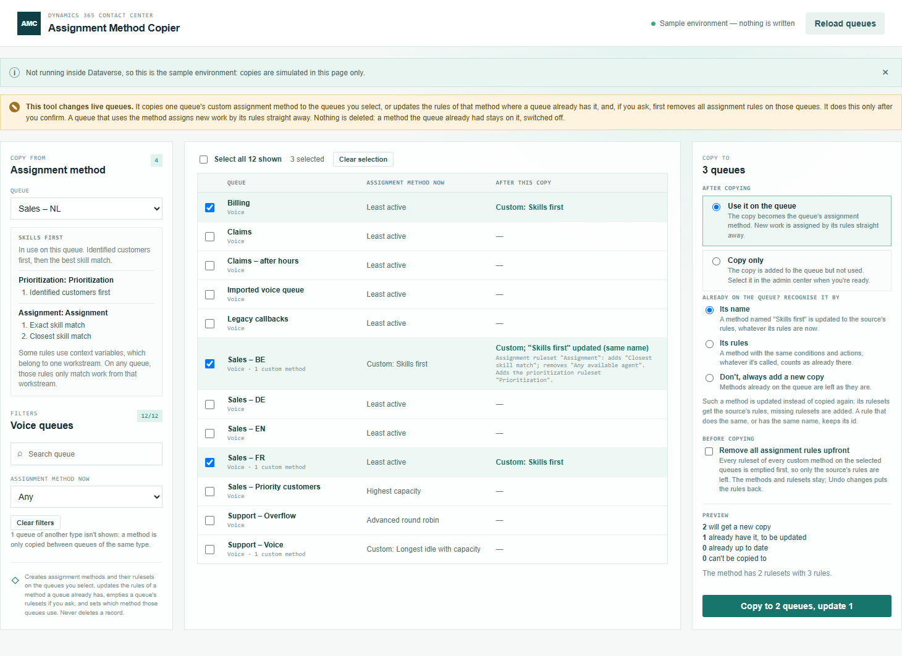
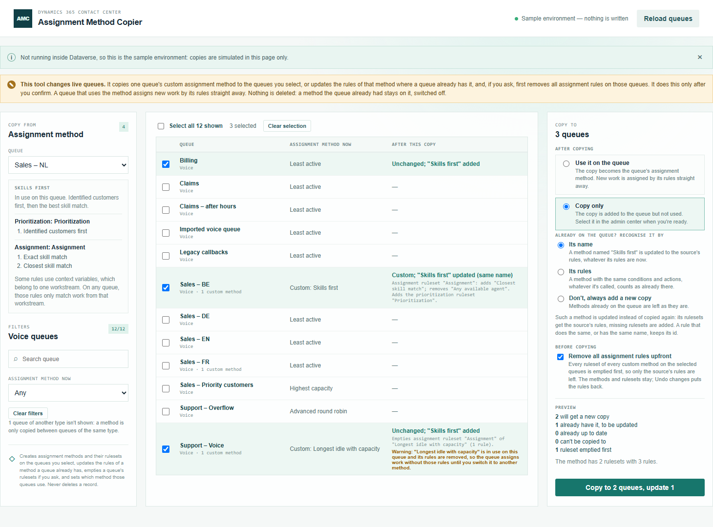
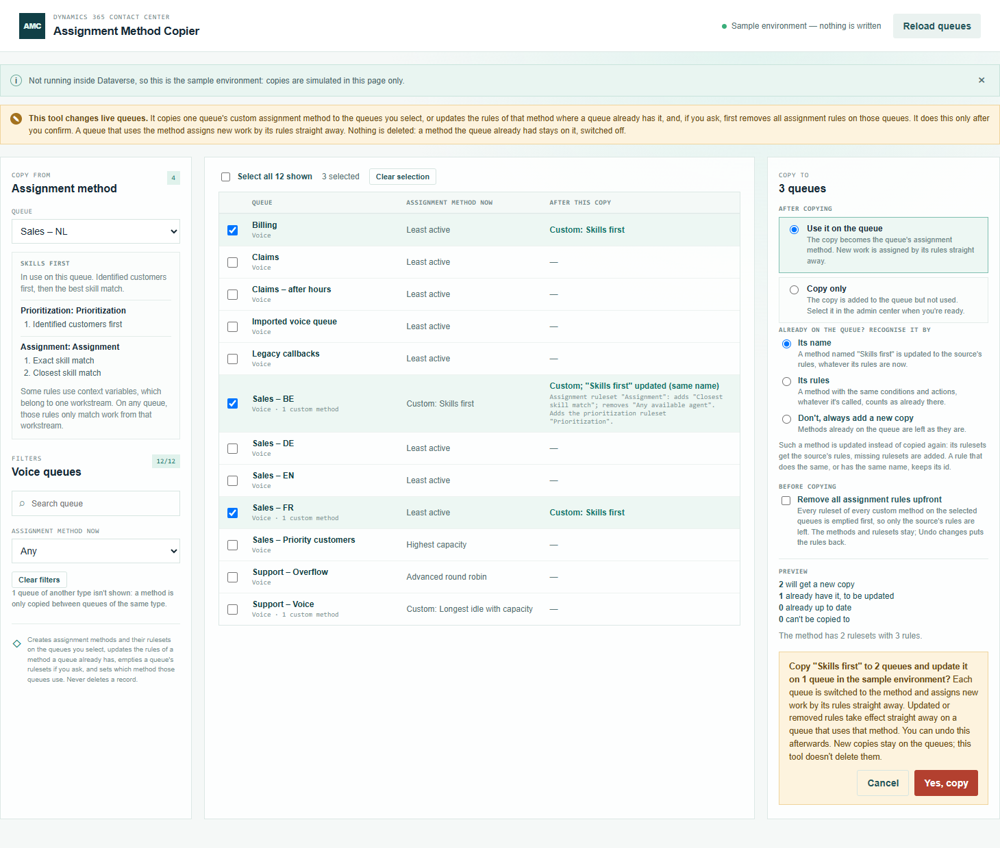
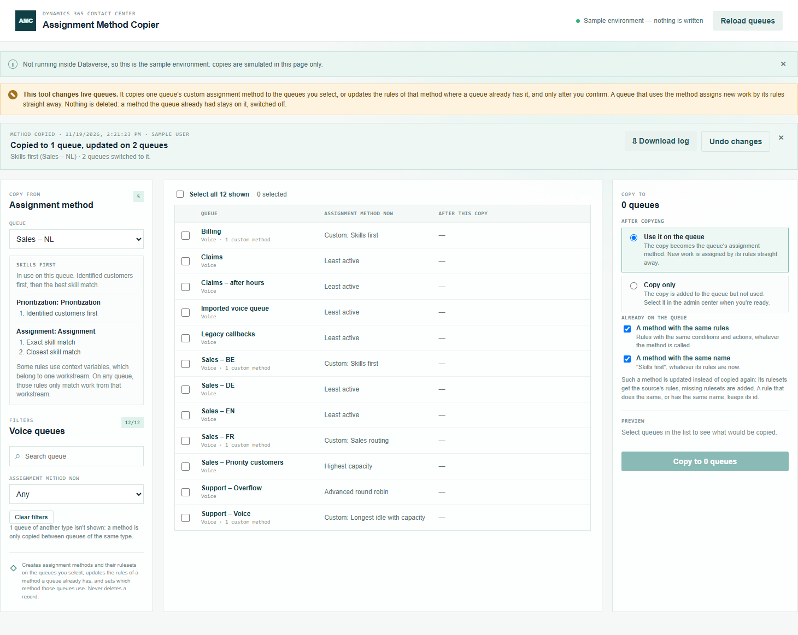
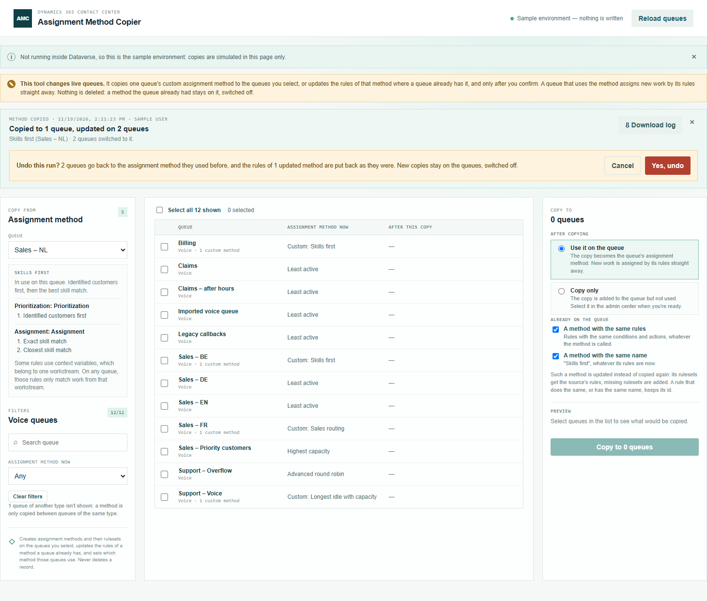

# Assignment Method Copier — manual

Copy one queue's custom assignment method to many other queues at once, or bring the method up to date on queues that already have it.

Before you start: build the custom assignment method on one queue in the admin center, with its prioritization and assignment rules. That queue is the one you copy from. To change the method on many queues later, change it on that queue and run the tool again.

## 1. Choose the method to copy

Open **Queue Assignment Method Copier** (under **Creation**) from the Promethean CCaaS Toolbox app. The topbar shows which environment it changes.

On the left, under **Copy from**, choose the queue that holds the method. Only queues with a custom method are offered. If the queue holds more than one, choose the method too.

The box below shows the method's rulesets and the rules in each, so you can check it's the right one. If the method can't be copied, the reason is shown here.

## 2. Select the queues

The list shows every other queue of the same type (voice, messaging or record), with the assignment method it uses now.

- Narrow the list with the search box or **Assignment method now** (for example, every queue on Least active).
- Tick queues one by one, or use **Select all N shown**. Selections are kept when you change the filters.

## 3. Choose what happens after copying

On the right, under **After copying**:

- **Use it on the queue**: the method becomes the queue's assignment method, and new work is assigned by its rules straight away.
- **Copy only**: the copy is added to the queue but not used. Select it in the admin center when you're ready.

## 4. Choose how a method already on the queue is recognised

Under **Already on the queue? Recognise it by**, choose one:

- **Its name** (default): the queue has a method with the source method's name, whatever its rules are now.
- **Its rules**: the queue has a method whose rules do the same (the same conditions and actions), whatever it's called.
- **Don't, always add a new copy**: every queue gets a new copy (numbered if the name is taken).

A recognised method is **updated** instead of copied again: its rulesets get the source's rules, and a ruleset it lacks is added. A rule that does the same as one already there, or has the same name, keeps its id. Rules the source doesn't have are removed from those rulesets.

Each row's **After this copy** column shows what happens to that queue:

| It says | What it means |
| --- | --- |
| **Custom: Name** | A new copy, switched on (or **Unchanged; "Name" added** with **Copy only**). |
| **Custom; "Name" updated (same name)** | The method on the queue is updated. The small text lists, per ruleset, the rules it adds, changes and removes. |
| **Custom: Name**, *Already there (same rules); it's switched on* | Nothing is rewritten; the method is only switched on. |
| **Already up to date** | The queue already has the method, as asked. Nothing is written. |
| **Can't copy** | The reason is shown, and the queue is left alone. |

The **Preview** box on the right counts each kind. A queue that already uses another custom method keeps it, switched off.

### Remove all assignment rules upfront

Under **Before copying**, tick **Remove all assignment rules upfront** to start every selected queue from a clean slate: each ruleset of each custom method on the queue loses its rules first, then the method is copied or updated. Only the source's rules are left on the queue. The methods and rulesets themselves stay, and **Undo changes** puts the rules back.

Each row lists the rulesets it empties. Watch for the orange **Warning**: when a queue's method in use is emptied and the queue isn't switched (for example with **Copy only**), that queue assigns work without those rules until you switch it. Choose **Use it on the queue** to avoid that.

## 5. Copy

Click the button below the preview (**Copy to N queues**, **Update on N queues**, or both). The confirmation names the environment and the method, and warns when updated rules take effect straight away:

Click **Yes**. Each queue gets the method and its rulesets, or has its method updated, is switched if you chose that, and is then read back to confirm.

The summary shows how many queues got the method and how many had it updated, when, and by whom. Queues with a problem are listed with the reason:

- **Failed**: nothing was created or changed on the queue.
- **Stopped part-way**: the queue wasn't switched. For a copy, an unfinished method is on the queue, switched off; delete it in the admin center. For an update, use **Undo changes** to put back the rules already rewritten.
- **Done, not confirmed**: it saved but reads back differently. Check the queue in the admin center.

**Download log** saves a CSV of the run, with every record created, every ruleset updated and the rule changes.

## 6. Undo

**Undo changes** puts every queue that was switched back on the assignment method it used before, and every updated or emptied ruleset back to the rules it had. New copies stay on the queues, switched off; this tool doesn't delete them.

The button is only there right after a run, while the tool still knows what each queue and ruleset had before. Later, change a queue's assignment method or rules in the admin center. The run log keeps a record of what changed.

## Good to know

- To change a method on many queues: change it on the source queue, then copy it again, recognising it by **Its name**. The copies on the other queues are updated in place.
- Updating the rules of a method a queue uses changes how its work is assigned straight away.
- Rules that use a context variable only match work from the workstream that variable belongs to.
- Outside the app the tool can't reach Dataverse and shows a sample environment instead; nothing is written there.
