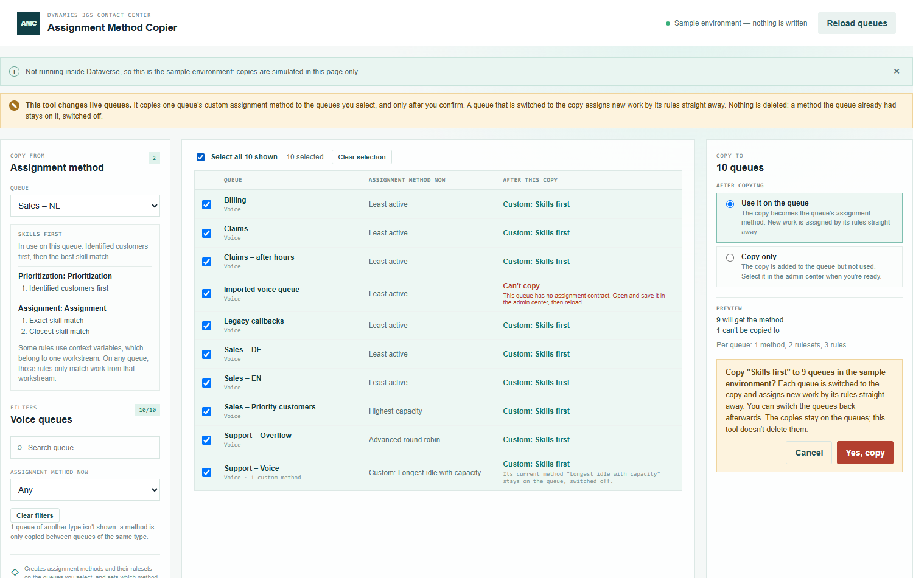
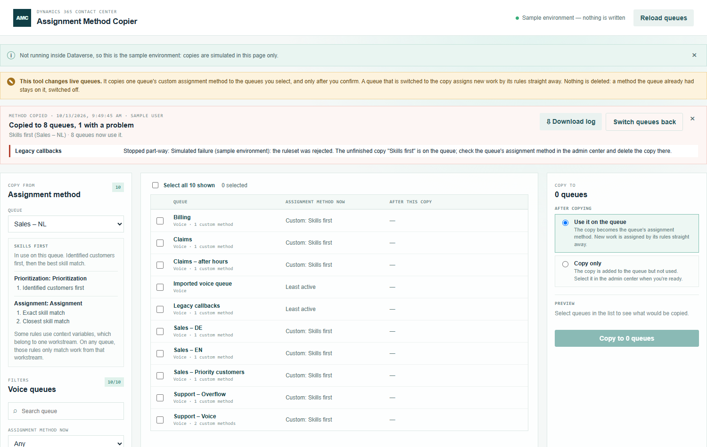
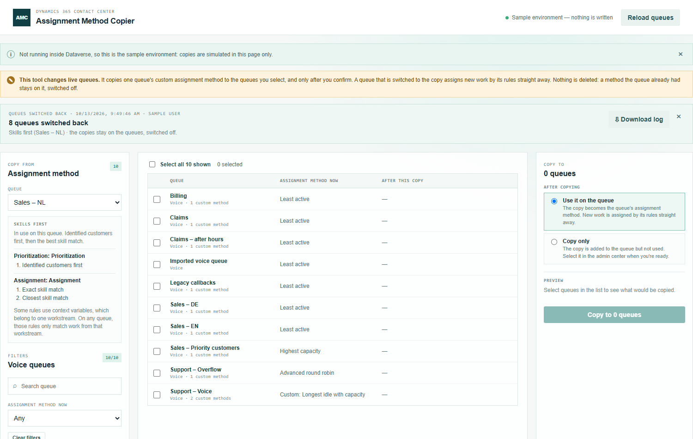

# Assignment Method Copier — manual

Copy one queue's custom assignment method to many other queues at once.

Before you start: build the custom assignment method on one queue in the admin center, with its prioritization and assignment rules. That queue is the one you copy from.

## 1. Choose the method to copy

Open **Queue Assignment Method Copier** (under **Creation**) from the Promethean CCaaS Toolbox app. The topbar shows which environment it changes.

On the left, under **Copy from**, choose the queue that holds the method. Only queues with a custom method are offered. If the queue holds more than one, choose the method too.

The box below shows the method's rulesets and the rules in each, so you can check it's the right one. If the method can't be copied, the reason is shown here.

## 2. Select the queues

The list shows every other queue of the same type (voice, messaging or record), with the assignment method it uses now.

- Narrow the list with the search box or **Assignment method now** (for example, every queue on Least active).
- Tick queues one by one, or use **Select all N shown**. Selections are kept when you change the filters.

## 3. Choose what happens after copying

On the right:

- **Use it on the queue**: the copy becomes the queue's assignment method, and new work is assigned by its rules straight away.
- **Copy only**: the copy is added to the queue but not used. Select it in the admin center when you're ready.

Each row's **After this copy** column shows what the queue's method would become. **Can't copy** gives the reason, and that queue is left alone. A queue that already uses a custom method keeps it, switched off.

## 4. Copy

Click **Copy to N queues**. The confirmation names the environment and the method:

Click **Yes, copy**. Each queue gets the method and its rulesets, is switched if you chose that, and is then read back to confirm.

The summary shows how many queues got the method, when, and by whom. Queues with a problem are listed with the reason:

- **Failed**: nothing was created on the queue.
- **Stopped part-way**: the queue wasn't switched. An unfinished copy of the method is on the queue, switched off; delete it in the admin center.
- **Done, not confirmed**: the copy saved but reads back differently. Check the queue in the admin center.

**Download log** saves a CSV of the run, with every record created.

## 5. Switch back

**Switch queues back** puts every queue that was switched back on the assignment method it used before. The copies stay on the queues, switched off; this tool doesn't delete them.

The button is only there right after a copy, while the tool still knows what each queue used before. Later, change a queue's assignment method in the admin center.

## Good to know

- Copying again adds another copy, named "Name (2)". To change a method on many queues, change it on the source queue and copy it again, then delete the old copies in the admin center.
- Rules that use a context variable only match work from the workstream that variable belongs to.
- Outside the app the tool can't reach Dataverse and shows a sample environment instead; nothing is written there.
