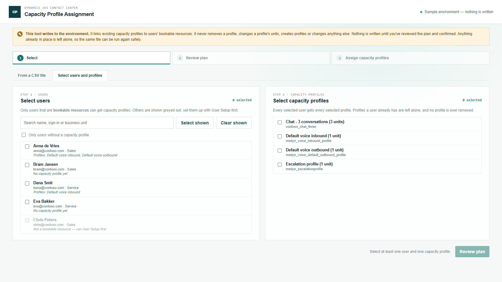

# Capacity Profile Assignment

Part of the [Promethean CCaaS Toolbox](../../Readme.md). It gives many users one or more **capacity profiles** at once, instead of opening each user in the Copilot Service admin center. Two ways in, same review and run:

- **Select users and profiles** (opens first). Tick users and capacity profiles in the page, and every selected user gets every selected profile. A filter shows only the users who don't have a capacity profile yet.
- **From a CSV file**. One row per user, with their capacity profiles.

Users must already be **bookable resources**: run [User Setup](../user-setup/README.md) first. User Setup also links capacity profiles when it creates the resource. This tool is for everything after that: a new profile for a whole team, or users who were set up without one.

See [IMPLEMENTATION_STATUS.md](IMPLEMENTATION_STATUS.md).



## Why capacity profiles matter

A capacity profile says how much work of one kind an agent can have at the same time, for example 1 voice call or 3 chats. A workstream asks for a capacity profile, and routing only assigns its work to agents who have that profile. An agent without the right profile never gets the work, even when they are a member of the queue.

## The CSV

One row per user.

| Column | Empty means | Notes |
| --- | --- | --- |
| `user` | **Required** | Sign-in name or email. The user must be in the environment and **already a bookable resource**. |
| `capacity_profiles` | **Required** | Capacity profiles by name or unique name, separated by `\|`: `Default voice inbound\|Default voice outbound`. |

```csv
user,capacity_profiles
anna@contoso.com,Escalation profile
bram@contoso.com,Default voice inbound|Default voice outbound
dana.smit@contoso.com,msdyn_voice_inbound_profile|Default voice outbound
```

## Safe to run again

A profile the user already has is shown as **in place** and left alone, so running the same file or selection twice changes nothing the second time. The tool never removes a profile and never changes a profile's units.

## Checks

| Check | Severity |
| --- | --- |
| User not found, ambiguous, disabled or not interactive; the same user on two rows | Error |
| The user isn't a bookable resource yet (run User Setup), or their resource is deactivated | Error |
| Capacity profile not found, ambiguous (use the unique name) or deactivated; listed twice on a row; no profiles on the row | Error |

## What gets written

One write: **Assign capacity profile**, a `createRecord` on `msdyn_bookableresourcecapacityprofile`. It sets:
- `msdyn_name`, which is the profile's unique name, as the admin center names it;
- the user's bookable resource and the profile, as bound lookups.

Max units on the link is left empty, so the profile's default applies. It's the same record User Setup creates.

Nothing is updated, deleted or deactivated, and no other table is written. The write-scope test in `tools/shared/tests/writeScopes.test.ts` fails the build if anything else appears.

## Build, run, deploy

```powershell
npm run demo:capacityassignment   # http://localhost:5451/index.html — sample environment, nothing is written
pwsh ./scripts/deploy.ps1 -Tool capacityassignment -CreateIfMissing   # first time
pwsh ./scripts/deploy.ps1 -Tool capacityassignment                    # afterwards
```

Web resources: `pct_/tools/capacityassignment/{index.html,style.css,bundle.js}`. In the packaged solution from **1.0.0.18** (Site Map: **Provisioning → Capacity Profile Assignment**). For an environment on an older solution version, add a Site Map subarea: Type Web Resource, `pct_/tools/capacityassignment/index.html`.
