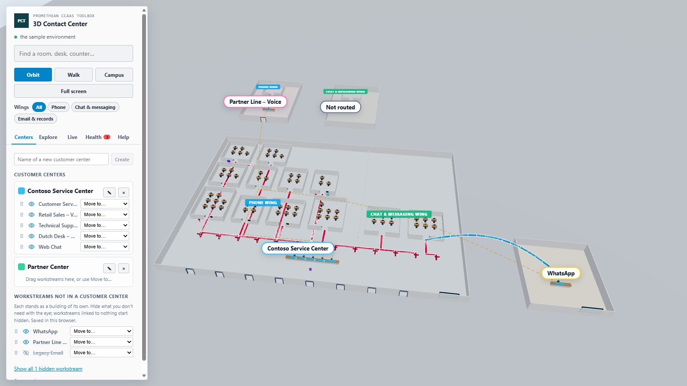
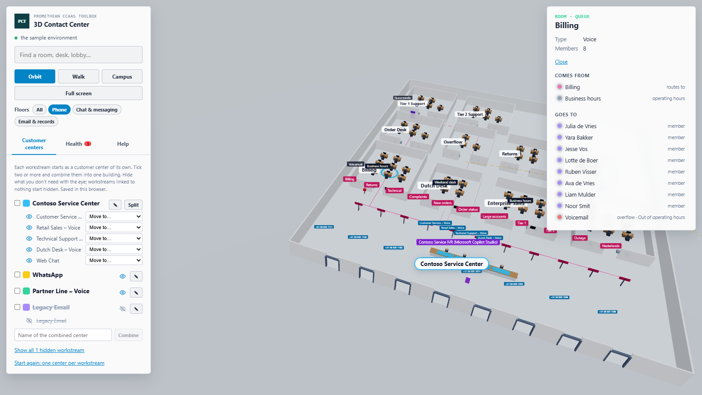
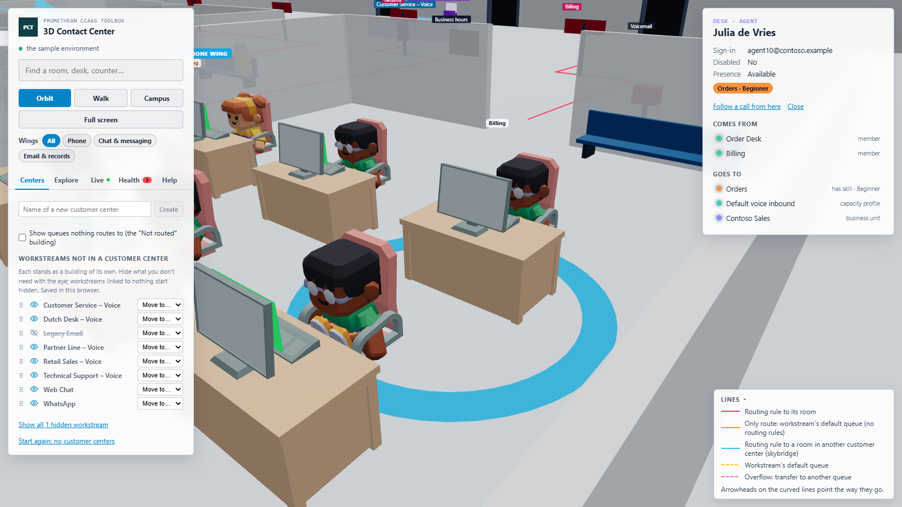
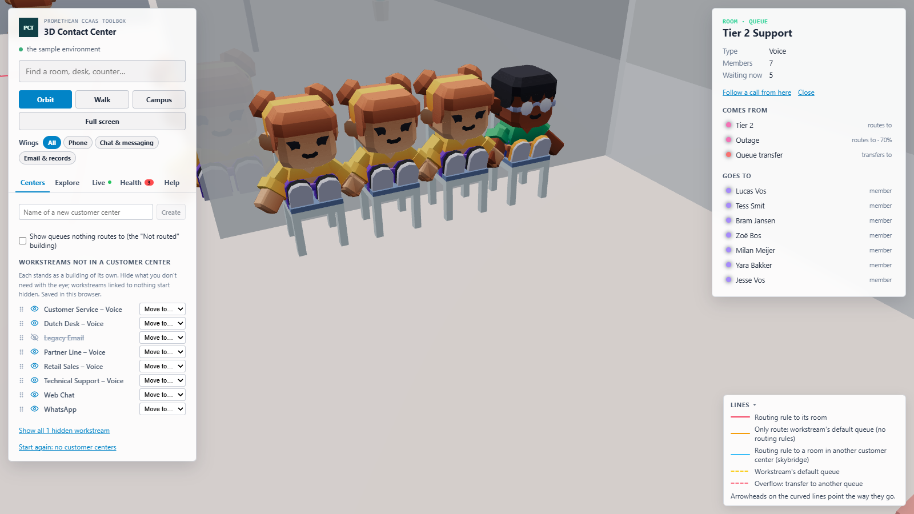
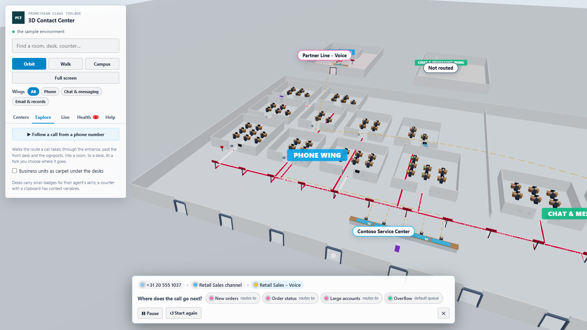

# 3D Contact Center

The same environment as the [Environment 3D Explorer](../environment-3d-explorer/README.md), shown from a business perspective: each customer center is a building on a campus, open at the top so you look inside from above. Read-only. Step by step: the [manual](manual.md).

## What you see

| In the building | CCaaS record |
| --- | --- |
| Building | a customer center: the workstreams you put in it (or one workstream, while it's in no center) |
| Entrance door, with the phone numbers on a sign above it | voice channel and its phone numbers |
| Screen at the entrance | the digital channels of the center's chat and email workstreams |
| One front desk, with a blue counter and a receptionist per workstream; plants in the lobby corners | workstream; a clipboard on the counter means it has context variables |
| Purple kiosk in front of the front desk | a workstream's bot (automated reception) |
| Signpost at the corridor, with a red line on the floor to its room | routing rule |
| Wing behind the corridor: **Phone**, **Chat & messaging**, **Email & records**, side by side | the kind of work: a queue's room is in the wing of its type |
| Room, with four waiting chairs inside, beside the door | queue; with live activity, waiting callers sit on the chairs (and stand beside them when they're full) |
| Desk with a monitor, an office chair and an agent sitting at it, small badges on its front | agent and their skills; with live activity the screen shows their presence colour |
| Carpet under a desk (when switched on) | the agent's business unit |
| Sign by the room's door | operating hours |
| Outside the room's front door | overflow: a mailbox (voicemail), a phone booth (callback or transfer to phone), an exit (end conversation), an amber block (remain in queue) |
| Purple door in the room's back wall | overflow: a transfer to another queue, with a dashed red line to that room |
| Blue skybridge | a routing rule to a room in another customer center |
| Solid orange line | a workstream without routing rules: its default queue is where every call goes; a sign behind its counter says so |
| Faint dashed yellow line | a workstream's default queue, the fallback beside its routing rules |
| "· default" after a room's name | the room is a shown workstream's default queue |
| "Not routed" building | queues no shown workstream routes to; hidden until you tick **Show queues nothing routes to** on the Centers tab |

## Customer centers

Dataverse doesn't know which workstreams belong together, so you make the customer centers. On the **Centers** tab:

- type a name and click **Create**: a new, empty customer center;
- move workstreams into it: **drag** a workstream onto the center, or pick the center in its **Move to…** list;
- **Move to… → Out of this center** puts a workstream back in a building of its own;
- rename a center (✎, or double-click its name), pick its colour (the swatch), or delete it (×; its workstreams stay, each in a building of its own);
- hide a workstream with the eye (and show it again). **Workstreams linked to nothing start hidden**: no channel or bot leads to them and they route nowhere. A room only hidden workstreams route to is hidden too.

Workstreams in no customer center are listed under it, each standing as a building of its own. Every change is remembered straight away, **in this browser, for this environment** (local storage). A shared store in Dataverse, so colleagues see the same centers, is planned: the page reads and saves through one small interface (`src/store.ts`).

## Rules of the layout

- One front desk per center, a counter per workstream; the signposts of all its workstreams share one corridor.
- A queue's room is in the wing of its type (a voice queue in the phone wing) of the center that routes to it most (ties: the first center in the list). Other centers reach it over a skybridge. A queue only reached by another queue's overflow transfer sits with that queue.
- Wings stand side by side; their rooms are in a grid about as wide as it's deep (4 rooms are 2 × 2, 9 are 3 × 3), in straight columns with aisles between them.
- Lines on the floor keep to the walkways and take the shortest way there, in straight lines at right angles: along the corridor and straight in at the door of a room in the front row; to a room further back, down the nearer aisle (left or right) and along the walkway in front of its row. They never cross a room.
- An agent has a desk in **every** queue room they are a member of; it's the same person, so clicking any of their desks selects them. Their presence colour shows on all their desks, and a caller with them stands at their desk in the room of the queue the call came from.
- The same environment and grouping always give the same plan.

## Using it

The left panel keeps search, the camera buttons (**Orbit**, **Walk**, **Campus**, **Full screen**) and the **Wings** filter (All, Phone, Chat & messaging, Email & records: shows one wing's rooms) on top, with tabs below:

- **Centers**: making and filling customer centers (above).
- **Explore**: **Follow a call** walks the route like a caller: from the entrance past the front desk and a signpost, along the line on the floor (corridor, aisle) and in at the room's front door, then waits at the room's bench until you choose the agent, and walks to that desk. It asks at each fork where the call goes. Also: business units as carpet.
- **Live**: live activity, read every 15 seconds (every 5 in the sample). Waiting callers sit on the waiting chairs inside a room's door (and stand beside them when they're full); a caller with an agent sits on a visitor's chair beside the desk, turned towards them; new callers walk in through the entrance, past their counter and along their call's line on the floor (over the curved line to another customer center) to the room, turning see-through while they pass through furniture on the way; desk screens light up in the agent's presence colour; rooms say "3 waiting".
- **Health**: the explorer's checks, as warning cones over the records.
- **Help**: the controls and what everything means.

Curved lines between buildings carry arrowheads in their own colour, pointing towards the room they go to. A **Lines** legend in the bottom-right corner explains the line styles (click it to fold it away). Click a building's name to fly to it; click a room, desk, counter, signpost, door or kiosk to see what it is (and follow a call from there). Labels are small and stay one size; inside a building they appear as you come closer (rooms and wings first, then signposts, then counters and phone numbers), so the campus from afar stays clear and labels near you stay readable while exploring.

**Guided tour**: **▶ Play the tour** on the **Help** tab (or `tour=1` in the page address) plays a tour of everything the tool can do, by itself, on the sample data: customer centers, the building, entrance doors, the bot, the front desk, signposts, wings, rooms and desks, business units, overflow, the lines between centers, following a call, live activity and health, about three minutes with a caption per step. Pause, step back or forward, or end it (Esc) in the bar on top. The customer center it makes isn't saved; yours come back when it ends. To record it as a video: open the tool in full screen (**F**), at 1920 × 1080 if you can, and record the screen (in Windows: Clipchamp, the Snipping Tool's video mode, or Win+Alt+R).

**Use sample data** (next to the environment name) shows the sample environment inside the app, to demonstrate or try the tool; it keeps its own saved customer centers. The page address can ask for `demo=1`, `focus=<name>` (a customer center or a record), `wing=voice` (or `messaging`, `records`), `unrouted=1` (show the Not routed building), `live=1`, `ride=1` and `tour=1` (play the guided tour); in a Site Map subarea, put them in the web resource's data parameter.

## How it works

It reuses the explorer's code rather than copying it: the Dataverse reads and the graph (`environment-3d-explorer/src/dataverse.ts`, `graph.ts`), the health checks, live activity (`live.ts`, `demoLive.ts`), the follow-the-call route (`ride.ts`), the sample environment, the camera rig and full screen. What's new:

- `src/centers.ts`: the customer centers (create, move, delete, rename, recolour, hide, and matching a saved grouping to today's workstreams).
- `src/store.ts`: where the grouping is kept.
- `src/floorplan.ts`: the plan, from graph and grouping to buildings, wings, areas, walls, fixtures, paths, anchors, waiting-bench seats, room doors and ways in. Pure.
- `src/CampusScene.tsx`: draws it. Floors and walls are instanced boxes; the desks, waiting chairs, plants and people are 3D models, drawn as one instanced mesh per model part, so large centers stay smooth.
- `src/models.ts`: the 3D models, from `models/` (Kenney's Furniture Kit and Mini Characters, CC0, see the licence files there). They're inlined in the bundle as data URLs (a web resource can't be a `.glb` file), and the characters are put in their sitting, standing and walking poses once, when they load. While they load, or if they can't, everything is boxes as before. The doors, signposts, kiosks and overflow fixtures (mailbox, phone booth, exit) stay simple shapes: the two kits have nothing that fits.

Tables read: the same as the explorer (with live activity: `msdyn_agentstatus` and `msdyn_ocliveworkitem`). Written: nothing; `tests/floorplan.test.ts` includes the read-only check.

## Build, run, deploy

- Demo with sample data: `npm run demo:contactcenter3d` → http://localhost:5449/index.html
- Tests: `npx jest tools/contact-center-3d`
- Deploy: `pwsh ./scripts/deploy.ps1 -Tool contactcenter3d` (add `-CreateIfMissing` the first time in an environment).
- Web resources: `pct_/tools/contactcenter3d/{index.html,style.css,bundle.js}`. In the packaged solution from **1.0.0.15** (Site Map: **3D → 3D Contact Center**). For an environment on an older solution version, add a subarea of type Web Resource for `pct_/tools/contactcenter3d/index.html` by hand (see the [toolbox README](../../Readme.md#site-map-subareas)).
