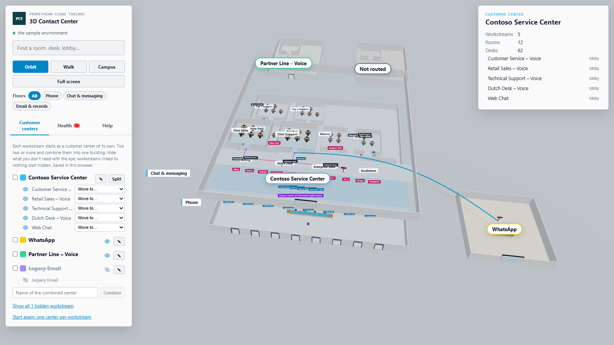

# 3D Contact Center — User Manual

Part of the [Promethean CCaaS Toolbox](../../Readme.md). For what the tool shows and how, see the [README](README.md).

## 1. Opening the tool

Open **3D Contact Center** from the toolbox app's Site Map. The tool reads the environment and shows the campus from above: a building per customer center, and a building of its own for every workstream that isn't in a customer center yet. The panel says which environment it's reading.

Nothing is changed in Dataverse. The tool only reads.

To demonstrate or try it without your own data, click **Use sample data** next to the environment name (or add `demo=1` to the page address). **Back to live data** returns to your environment. The sample keeps its own customer centers, separate from yours.

## 2. Looking around

- **Orbit** (the default): drag to rotate, scroll to zoom, right-drag to pan.
- **Walk**: drag to look around; walk through the building with W A S D.
- **Campus** flies back to the view of all buildings. **Full screen** (or F) hides the app's menu; Esc goes back.
- **Wings**: show the rooms of one wing only (Phone, Chat & messaging, Email & records), or All.
- Click a building's name to fly to it. Inside, the rooms, counters, signposts and signs get their names; they appear as you come closer, and stay small.

## 3. Reading a building

From the front (the entrance) to the back:

1. **Entrance doors**: one per voice channel. The blue sign above shows its phone numbers. A **screen** at the entrance stands for the digital channels (chat, messaging, email).
2. **Purple kiosk**: a workstream's bot, the automated reception.
3. **Front desk**: one per customer center. Each **blue counter** on it is a workstream; a clipboard on a counter means the workstream has context variables.
4. **Signposts** at the corridor: the routing rules. A red line on the floor leads to the room each rule sends calls to.
5. **Wings**, side by side: **Phone**, **Chat & messaging** and **Email & records**, each with its name on the floor. A queue's room is in the wing of its type.
6. **Rooms**: the queues. The blue bench inside, beside the door, is where callers wait. Each **desk** has the agent behind it; the small coloured badges on the desk are the agent's skills.
7. **By a room's door**: its opening hours (dark sign) and its overflow: a red mailbox for voicemail, a glass phone booth for a callback, a green exit for ending the conversation. A **purple door in the back wall** is an overflow transfer to another queue: the dashed red line leads from it to that room.

A blue **skybridge** goes to a room in another customer center. A faint dashed yellow line goes to a workstream's default queue, a dashed red one is an overflow transfer to another queue. Arrowheads on the curved lines point the way they go, towards the room. The **Lines** legend in the bottom-right corner shows them all; click it to fold it away.

Click anything to see what it is, its details, and what it's linked to. Click a link to go there.

## 4. Making customer centers

Open the **Centers** tab.

1. Type a name, for example "Contoso Service Center", and click **Create**. The new center appears at the top, still empty.
2. Put workstreams in it: **drag** a workstream from the list onto the center, or choose the center in the workstream's **Move to…** list. The workstreams move into one building, with one front desk and a counter for each.
3. **Move to… → Out of this center** gives a workstream its own building again.
4. **✎** (or double-click the name) renames a center, the coloured square picks its colour, and **×** deletes it (its workstreams stay, each in a building of its own).
5. The **eye** hides a workstream (click again to show it). Workstreams linked to nothing start hidden. **Show all … hidden workstreams** brings them all back.
6. **Start again** removes every customer center.
7. **Show queues nothing routes to** shows the "Not routed" building, with the rooms of queues that no shown workstream routes to. It's hidden at first.

Your centers are remembered in this browser, for this environment.

## 5. Following a call

On the **Explore** tab, click **Follow a call** (from the selected record, or from a phone number), or **Follow a call from here** in a record's details. The camera walks the route the way a caller would: in through the entrance, past the front desk and a signpost, along the line on the floor and in at the room's front door. There it waits at the waiting bench until you choose an agent, then walks to that desk. At a fork the bar at the bottom asks **Where does the call go next?**; **Pause**, **Start again** and **×** (or Esc) are there too.

On the same tab, **Business units as carpet** puts a coloured carpet tile under each desk, one colour per business unit.

## 6. Watching live activity

Open the **Live** tab and tick **Live activity**. It reads again every 15 seconds (every 5 in the sample).

- Callers waiting in a queue sit on the bench inside its door; when the bench is full, they queue up outside the door.
- A caller with an agent stands at the agent's desk.
- A new caller walks in through the entrance, past the front desk, to the room.
- Desk screens light up in the agent's presence colour: green available, red busy, dark red do not disturb, amber away, grey offline.
- A room with callers waiting says how many, for example "Billing · 3 waiting".

## 7. Finding problems

Open the **Health** tab and tick **Show problems**. Records with a problem get a red cone above them, warnings an amber one. The list shows them all; click one to fly there. The checks are the explorer's: see its [README](../environment-3d-explorer/README.md#health-overlay).

## 8. Opening from a link

Add `focus=<name>` to the page address to open on the customer center (or a record) with that name, `wing=voice` (or `messaging`, `records`) for one wing, `unrouted=1` for the Not routed building, `live=1` for live activity, `ride=1` to follow a call from the focused record, and `demo=1` for the sample. In a Site Map subarea, put them in the web resource's **data** parameter.
