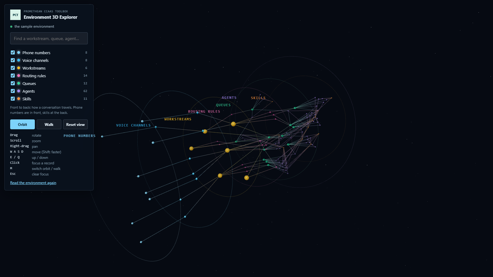
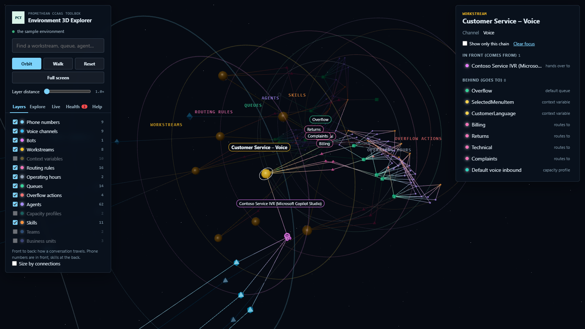
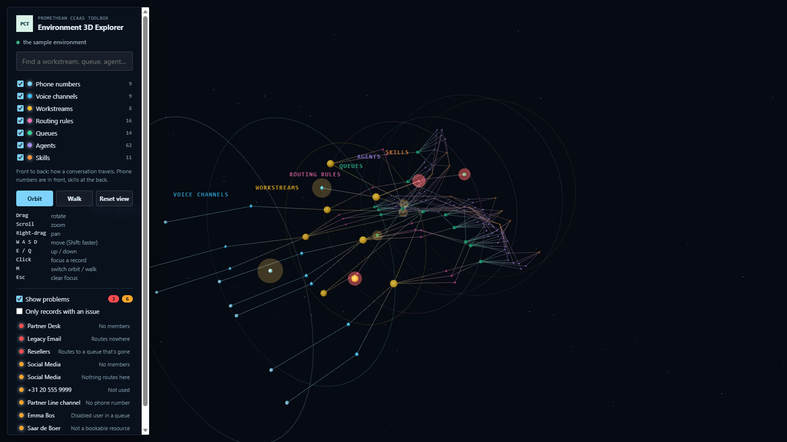

# Environment 3D Explorer

Shows the whole contact center as a 3D cloud of records you can rotate, zoom into and walk through. Read-only. Step by step: the [manual](manual.md).

## What you see

Each record type sits on its own depth layer. Front to back follows the way a conversation travels:

| Layer (front → back) | Shape | Linked to the next layer by |
| --- | --- | --- |
| Phone numbers | small sphere | the voice channel that uses the number |
| Voice channels | diamond | the channel's workstream |
| Workstreams | large ball | the route-to-queue rules of the active routing configuration, and the default queue |
| Routing rules | pyramid | the queue(s) the rule routes to (weighted distributions show the percentage) |
| Queues | cube | the queue's members |
| Agents | small sphere | the agent's skills (with rating) |
| Skills | dodecahedron | — |

A faint ring marks each layer. Within a layer, a record sits near the records it's linked to, so connected things line up front to back.

## Using it

- **Click a record** (or find it with the search box) and the camera flies to it, from a little in front and to the side. Its whole chain lights up: everything in front of it (where its work comes from) and everything behind it (where the work goes). The rest dims. The panel on the right lists its details and direct links. Click a link to move on to that record.
- **Show only this chain** hides everything else, which helps when you walk through it.
- **Orbit mode**: drag to rotate, scroll to zoom, right-drag to pan.
- **Walk mode**: drag to look around. You turn the view by dragging, without pointer lock, so walk mode also works inside the model-driven app's frame.
- **Both modes**: W A S D or the arrow keys move, E/Q go up and down, Shift moves faster. M switches mode, Esc clears the focus.
- The checkboxes in the legend hide or show a layer.
- **Fly through** tours the focused chain (or, with nothing focused, everything shown) one layer at a time, front to back, with a caption per stop. It has pause, previous/next and stop controls; Esc also stops it.
- **Size by connections** makes each record's size show how many links it has, so busy queues and big workstreams stand out.
- **Save view** keeps the current camera position under a name; click a saved view to fly back to it. Saved views stay in this browser, per environment.
- **Screenshot** downloads the current view as a PNG (without the name labels, which are HTML on top of the scene).
- The page address can ask for `focus=<name>`, `health=1` and `tour=1` (start the fly-through when the page opens). On a Site Map subarea, put them in the web resource's data parameter, for example `focus=Sales&tour=1`; a plain data value is read as a record name.

## Health overlay

**Show problems** (left panel) puts a pulsing glow around every record with an issue: red for a **problem** (conversations can get stuck or lost there), orange for a **warning** (worth a look, but it can be on purpose). The panel lists them, problems first. Click one to fly to it with its chain lit. **Only records with an issue** shows just those records and their direct links. A selected record's findings, with a suggested fix, are always in the details panel.

| Record | Check | Severity |
| --- | --- | --- |
| Workstream | Default queue isn't an active omnichannel queue | Problem |
| Workstream | No route-to-queue rules and no default queue ("routes nowhere") | Problem |
| Workstream | No route-to-queue rules, so everything goes to the default queue | Warning |
| Workstream | Voice workstream without a voice channel | Warning |
| Voice channel | No phone number | Warning |
| Phone number | Not used by any voice channel | Warning |
| Routing rule | Routes to a queue that isn't an active omnichannel queue | Problem |
| Queue | No members (or only disabled members): a problem when something routes to it, a warning otherwise | Problem / Warning |
| Queue | Nothing routes to it (no rule, not a default queue) | Warning |
| Agent | Disabled user still in a queue | Warning |
| Agent | Queue member without a bookable resource | Warning |

The checks use only the data the scene already has, so the overlay reads nothing extra. A check that needs a table that couldn't be read is skipped, and the panel says which. For a full clean-up review, use the Environment Artifact Finder; for one agent in depth, the Agent Readiness Checker.

## How it works

- `src/dataverse.ts` reads the tables below with `Xrm.WebApi.retrieveMultipleRecords` (through `shared/src/xrm.ts`). Phone numbers, voice channels and skills are optional: if one of them can't be read, the rest still shows and the page says what's missing.
- `src/graph.ts` turns the rows into nodes and edges, with edges pointing downstream. It reuses Visual Routing Tester's decision-XML parser for the route-to-queue rules.
- `src/health.ts` runs the health checks on the graph.
- `src/tour.ts` builds the fly-through, `src/views.ts` keeps the saved views and `src/urlOptions.ts` reads the page address.
- `src/layout.ts` places the nodes deterministically, so the same environment always gives the same picture.
- `src/Scene.tsx` draws them with [Three.js](https://threejs.org) through React Three Fiber and drei. Each record type is one instanced mesh, and all the lines are one geometry, so thousands of records stay smooth.

### Tables read

`msdyn_ocphonenumber`, `msdyn_ocvoicechannelsetting`, `msdyn_liveworkstream` (active), `msdyn_routingconfiguration`, `msdyn_routingconfigurationstep`, `msdyn_decisionruleset` (the route-to-queue rulesets only), `queue` (active omnichannel queues, not `<CDS System>`), `queuemembership`, `systemuser` (interactive users), `bookableresource`, `bookableresourcecharacteristic` (with its characteristic and rating).

Agents are the users who are a member of at least one omnichannel queue.

### Written

Nothing. `tests/readOnly.test.ts` fails if any source file names a write method or calls `fetch`, and checks that loading the environment only calls `retrieveMultipleRecords`.

## Build, run, deploy

- Demo with sample data: `npm run demo:explorer3d` → http://localhost:5448/index.html
- Tests: `npx jest tools/environment-3d-explorer`
- Deploy: `pwsh ./scripts/deploy.ps1 -Tool explorer3d` (add `-CreateIfMissing` in an environment where its web resources don't exist yet).
- Web resources: `pct_/tools/explorer3d/{index.html,style.css,bundle.js}`. In the packaged solution from **1.0.0.12** (Site Map: **3D → 3D Explorer**). For an environment on an older solution version, add a subarea for `pct_/tools/explorer3d/index.html` by hand (see the [toolbox README](../../Readme.md#site-map-subareas)).

The bundle is about 1 MB, because Three.js is included. The other tools are about 200 KB each.
