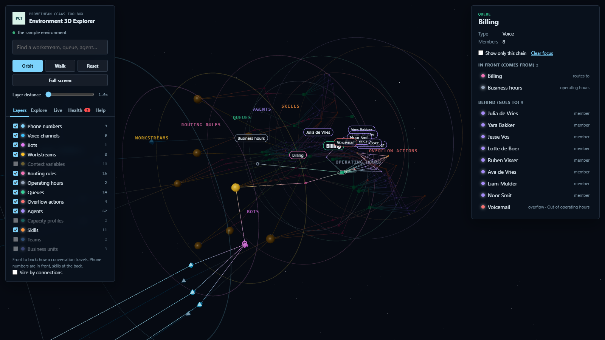
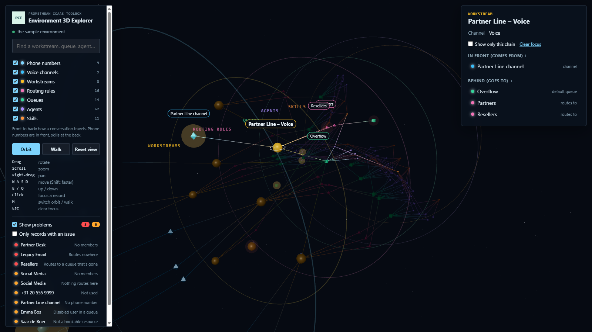
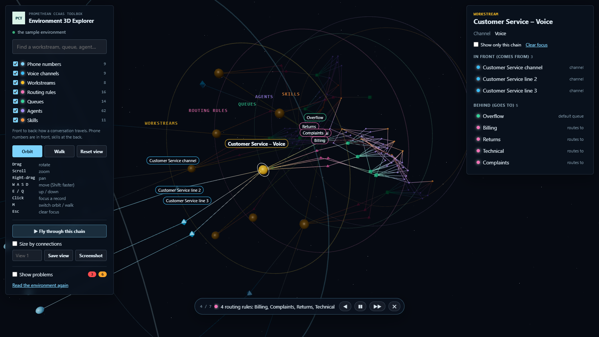

# Environment 3D Explorer — User Manual

Part of the [Promethean CCaaS Toolbox](../../Readme.md). For what the tool shows and how it works, see the [README](README.md). This manual walks through using it.

## 1. Opening the tool

1. In the Promethean CCaaS Toolbox model-driven app, open **3D → 3D Explorer** from the Site Map.
2. The tool reads the environment straight away. The left panel shows which environment it's reading. If it says **the sample environment**, the page isn't running inside the app and shows made-up data.
3. Nothing is changed. The tool only reads.

When the scene appears, you look at the environment from the front and a little to the side. Each record type is on its own layer, marked by a faint ring and a label. Front to back: phone numbers, voice channels, workstreams, routing rules, queues, agents, skills. Lines connect records that are linked.

The legend in the left panel shows how many records of each type were read. Untick a type to hide that layer, and tick it again to show it.

If something couldn't be read (phone numbers, voice channels or skills, for example when you have no permission on that table), a link under the controls says how many things are missing. Click it to see which. The rest of the scene still shows.

## 2. Looking around

There are two modes. Switch between them with the **Orbit** and **Walk** buttons, or press **M**.

- **Orbit** (the default): drag to rotate around the point you're looking at, scroll to zoom in and out, and right-drag to pan.
- **Walk**: drag to look around from where you stand, like turning your head.

In both modes the keyboard moves you:

| Key | Moves |
| --- | --- |
| W / ↑ | forward |
| S / ↓ | back |
| A / ← and D / → | left and right |
| E and Q | up and down |
| Shift (held) | faster |

Click the scene once first, so the page gets the keys. **Reset view** flies you back to the starting view.

Hover over a record to see its type and name at the bottom of the screen.

## 3. Focusing on a record

Click a record, or type part of its name in the search box and pick it from the list. The camera flies to it, so you see what comes before it in front of you and what follows it behind.

- Its whole chain lights up, and everything else dims. The chain is everything its work comes from (in front) and everything its work goes to (behind). Focusing a queue, for example, lights up the rules and workstreams that route to it and the agents in it, but not the other queues.
- The record and the records it's directly linked to get a name label. A white ring marks the record itself.
- The panel on the right shows the record's details, and its direct links under **In front (comes from)** and **Behind (goes to)**. Click a link to move on to that record.
- **Show only this chain** hides everything else, which makes it easier to walk through the chain.
- **Open record ↗** opens the record in a new tab. For a routing rule, that's the ruleset the rule belongs to.
- **Clear focus** (or **Esc**) lights everything up again.

## 4. Finding problems

Tick **Show problems** in the left panel. The two counters next to it show how many problems (red) and warnings (orange) were found.

- Every record with an issue gets a pulsing glow: red for a problem (conversations can get stuck or lost there), orange for a warning (worth a look, but it may be on purpose).
- The list under it shows every issue, problems first. Click one to fly to that record with its chain lit, so you see what it affects: for example, which workstreams route to an empty queue.
- **Only records with an issue** hides everything else except their direct links.
- When you select a record, its findings and a suggested fix appear in the details panel, also when the overlay is off.

The [README](README.md#health-overlay) lists every check. If a table couldn't be read, the checks that need it are skipped and the panel says so.

## 5. Fly-through, views and screenshots

These are under the mode buttons in the left panel.

- **Fly through this chain** (or **the environment**, when nothing is focused) moves the camera layer by layer from the front to the back: phone numbers, channels, workstreams, routing rules, queues, agents, skills. A bar at the bottom shows the stop, a caption with what's there, and buttons to go back, pause or play, go forward and stop. Esc also stops it. With **Show only this chain** ticked, the tour shows only the chain.
- **Size by connections** makes a record bigger the more links it has: a queue with many members and rules routing to it, a workstream with many channels and rules.
- **Save view** keeps the current camera position. Type a name first, or leave it empty for "View 1", "View 2" and so on. Click a saved view to fly back to it, and × to delete it. Saved views stay in this browser, for this environment only.
- **Screenshot** downloads what you see as a PNG. The name labels aren't in the picture.

## 6. Reading the environment again

The scene shows the environment as it was when the page loaded. After you change something in the admin center, click **Read the environment again**.

## 7. Opening the tool from a link

Add `?focus=<name>` to the page address to open the explorer focused on the record with that name. For example: `…/index.html?focus=Customer%20Service`. In a Site Map subarea, the same name can go in the web resource's **data** parameter. Add `health=1` (for example `…/index.html?health=1`) to open it with the health overlay on, and `tour=1` to start the fly-through as soon as the page opens (together with `focus`, it tours that record's chain). In a Site Map subarea, put them in the **data** parameter, for example `focus=Customer Service&tour=1`.
