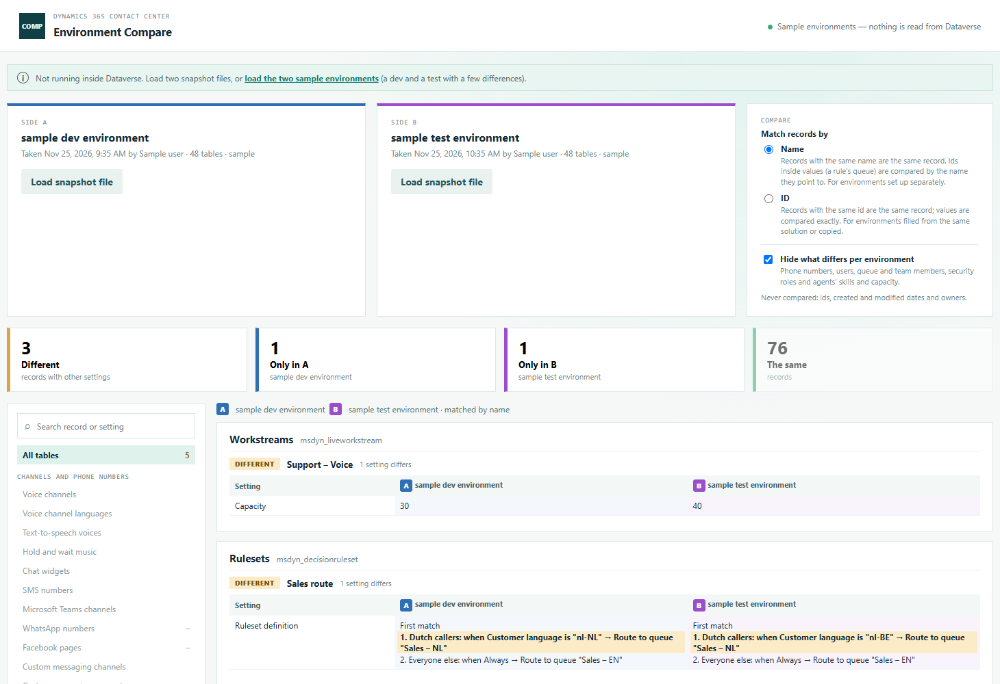

# Environment Compare

Part of the [Promethean CCaaS Toolbox](../../Readme.md). A **read-only tool**: it compares the contact center configuration of two environments (dev and test, test and production) or of one environment at two moments, and shows what's only in one of them and every setting that differs.

It compares **snapshot files** from [Environment Snapshot](../environment-snapshot/README.md). A tool running in one environment can't read another one (each environment needs its own sign-in), so you take a snapshot in each environment and compare the files; one side can also be a fresh snapshot of the environment the tool runs in.

See the [manual](manual.md) for a walkthrough with screenshots.



## How it works

1. **Side A and side B.** For each side, load a snapshot file (*Download snapshot file* in Environment Snapshot), or take a snapshot of the environment this page runs in.
2. **Match records by**:
   - **Name**: records with the same name are the same record. Record ids inside values (a rule's target queue, a lookup) are replaced by the name of the record they point to, so a rule that routes to "Sales – NL" is the same in both environments whatever that queue's id is. For environments that were set up separately.
   - **ID**: records with the same id are the same record, and values are compared exactly. For environments filled from the same solution or copied from each other.
3. **Read the result**: four tiles (different, only in A, only in B, the same) that also filter the list; tables by section with their number of differences; per record the settings that differ, with both values side by side. Search finds a record or a setting.

## What's compared

Every table and every column of the snapshot, except:

- **Never compared**, because they always differ between environments: record ids, created and modified dates, created by, modified by and owner. Matching by name also leaves out unique names and other id columns.
- **Marked as differing per environment**, and hidden while *Hide what differs per environment* is on (the default): phone numbers (the numbers table, and the number and caller ID of channels), users, queue and team members, security roles, bookable resources with their skills and capacity profiles, and workstream bots.

**Routing rules** are compared as rules: matching by name, a ruleset's definition is worded (as in the snapshot document) and compared line by line, so the rule ids inside it don't count, and a changed rule is marked. Matching by ID compares the definition exactly.

**Link records** without a meaningful name (a workstream's capacity profile, an agent's skill, a channel's language, a context variable, a routing step) are matched by the records they link, for example *Ava Jansen · Dutch*. When names aren't unique, the records they link are added to tell them apart; any left sharing a name are compared in order, and say so.

A table that isn't installed or couldn't be read on one side is noted and not compared, so it doesn't show as "only in" the other side.

## Permissions and safety

The tool **only reads**: snapshot files from your computer, and for a fresh snapshot, Environment Snapshot's read-only reader. `tests/readOnly.test.ts` fails if `src/` writes or calls the Web API itself. Snapshot files hold no secrets (Environment Snapshot drops them on read), but they do hold configuration and the names of people in queues: treat them like any other export.

## Build, run, deploy

```powershell
npm install
npm test
npm run demo:compare   # http://localhost:5456/index.html — two sample environments, nothing is read from Dataverse
pwsh ./scripts/deploy.ps1 -Tool compare -CreateIfMissing   # first time
pwsh ./scripts/deploy.ps1 -Tool compare                    # afterwards
```

Web resources: `pct_/tools/compare/{index.html,style.css,bundle.js}`. In the packaged solution from **1.0.0.28** (Site Map: **Tools → Environment Compare**). For an environment on an older solution version, add a subarea for `pct_/tools/compare/index.html` by hand (see the [toolbox README](../../Readme.md#site-map-subareas)).
