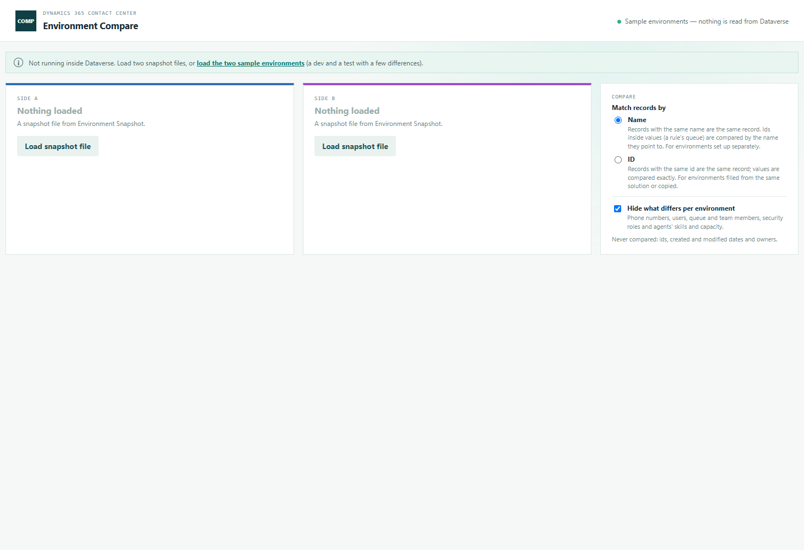
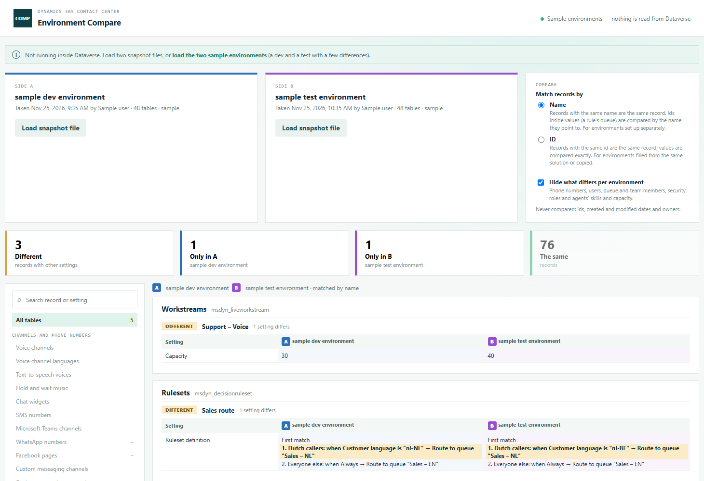
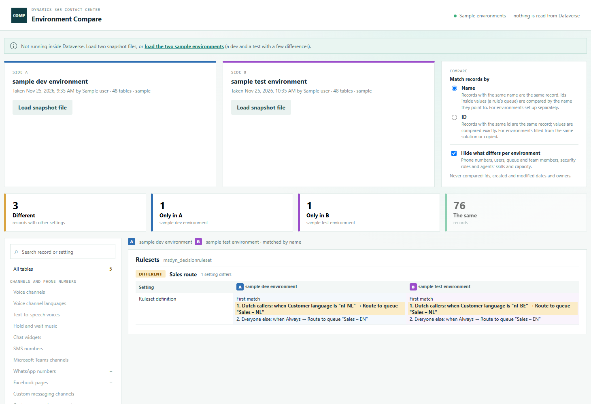
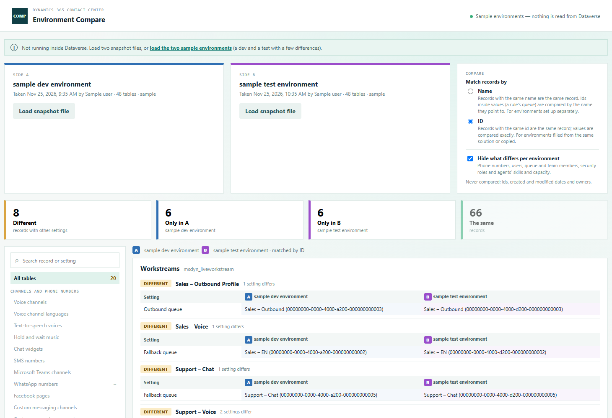

# Environment Compare — manual

Compare the configuration of two environments, for example to check that what's configured on dev is also on test and production, or compare one environment with an earlier snapshot of itself to see what changed. The tool only reads.

## 1. Get the snapshot files

In each environment you want to compare, open **Environment Snapshot**, click **Take snapshot**, then **Download snapshot file**. That saves a `.json` file named after the environment and the time. (The PDF and the Excel workbook are for reading; the snapshot file is the one to compare.)

You can also compare against the environment you're in without a file: Environment Compare can take that snapshot itself.

## 2. Load side A and side B

Open **Environment Compare**.

For **Side A** and **Side B**, click **Load snapshot file** and choose a file, or click **Snapshot of <this environment>** to read the environment you're in now. Each side shows which environment it is, when the snapshot was taken and by whom.

## 3. Choose how records are matched

Under **Compare**, **Match records by**:

- **Name**: when the environments were set up separately (by hand, or with the toolbox's creation tools in each). A queue called *Sales – NL* is the same queue in both, whatever its id. Rules that point to it are compared by its name too.
- **ID**: when one environment was filled from the other with a solution or a copy, so records have the same ids.

Leave **Hide what differs per environment** on to leave out what's meant to differ (phone numbers, users, memberships, roles). Turn it off to see those too; they're marked *per environment*.

## 4. Read the differences

- The four tiles count records that are **different**, **only in A**, **only in B** and **the same**. Click a tile to show or hide those records.
- On the left, every table by section, with its number of differences. Click one to see only that table; **All tables** shows every table with differences.
- Per record, the settings that differ, with the value in A and in B. A setting marked *per environment* is expected to differ.

Routing rules are shown in words. A changed rule is highlighted on both sides:

The same two environments matched by ID: the queues were created separately and have other ids, so they show as only in A and only in B, and everything pointing to them differs. That's the signal to match by name instead.

## Good to know

- Ids, created and modified dates and owners are never compared: they always differ.
- A table that isn't installed or couldn't be read in one environment is noted at the top of that table, and not compared.
- Outside the app, **load the two sample environments** shows a dev and a test with a few differences planted.
