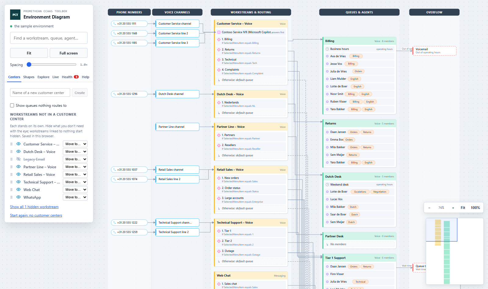

# Environment Diagram

Part of the [Promethean CCaaS Toolbox](../../Readme.md). The whole Dynamics 365 Contact Center as one **Visio-style diagram**: a cross-functional flowchart that reads left to right, the way a call travels. It's the 2D twin of the [Environment 3D Explorer](../environment-3d-explorer/README.md) and [3D Contact Center](../contact-center-3d/README.md), on the same data and with the same features. Read-only. Step by step: the [manual](manual.md).

## How the diagram is laid out

Five swimlanes, left to right: **Phone numbers · Voice channels · Workstreams & routing · Queues & agents · Overflow**. What belongs to a record is drawn inside it, as in a Visio container:

| Shape | CCaaS record |
| --- | --- |
| Phone number (pill with a phone icon) → voice channel | the number and the channel that uses it |
| Container in the workstreams lane | a workstream: its bot, its route-to-queue rules in the order they're checked (a diamond, with the condition), and "Otherwise: default queue" |
| Container in the queues lane | a queue: its operating hours and its members (agents) |
| Row in a queue | an agent; their skills, capacity profiles, teams and business unit are tags on the row. An agent in three queues is drawn in all three |
| Shape in the overflow lane | an overflow action, with its trigger on the line; a queue transfer goes on to its queue |
| Dashed container around workstreams | a customer center (see below) |
| Solid line / dashed line | what a call travels / a workstream's default queue |

Workstreams and queues are always drawn; the other kinds can be switched off on the **Shapes** tab (context variables, capacity profiles, teams and business units start off). The diagram closes up around what's left.

## What you can do

- **Centers** (opens first): the same as 3D Contact Center's tab and the same saved grouping, so a customer center made in either tool shows in both. Create, rename, recolour and delete customer centers, drag workstreams in or use **Move to…**, hide workstreams with the eye (workstreams linked to nothing start hidden), and **Show queues nothing routes to** (off at first, as in 3D Contact Center).
- **Select** a shape: everything before and after it lights up, the rest fades; every copy of an agent lights up. The details panel lists its connections, health findings, live figures and **Open record**; for a workstream, its customer center. **Show only this chain** redraws the diagram with just that chain. A click in the diagram never moves the view; picking from search or a list scrolls only when the record is off screen.
- **Explore**: follow the call (a dot runs along the lines; you pick at a fork), save views, and **download** the diagram as **SVG** (Visio opens it; right-click → Convert to Shape to edit it) or **PNG**.
- **Live**: agents in their presence colour with a count of their conversations, waiting calls per queue, open conversations per workstream, and new calls running along the line into their queue.
- **Health**: problems and warnings marked on the shapes, a list with fixes, and **Only records with an issue**.
- **Help**: the guided tour (also `?tour=1`), keys and a key to the shapes.
- Pan by dragging, zoom with the wheel or the **− % +** buttons, **Fit** to see everything, a minimap, full screen (**F**). It opens fitted to the width of the screen, starting at the top.
- Sample data inside the app, and the 3D Explorer's address options (`?focus=`, `?health=1`, `?ride=1`, `?live=1`, `?tab=`, `?depth=` for the spacing).

## How it works

It reuses the other two tools' code rather than copying it: the Dataverse reads and the graph, health, live activity, follow-the-call, the guided tour and full screen from the explorer; the customer centers and their storage from 3D Contact Center. What's new:

- `src/layout.ts`: from the graph to swimlanes, containers, rows, tags and right-angled connectors. Pure, and tested.
- `src/Diagram.tsx`: draws it as SVG, with pan, zoom, minimap, highlighting, health and live marks, the ride and the exports. Colours are attributes, so the saved SVG looks the same.
- `src/Centers.tsx`: the Centers tab (the same markup as 3D Contact Center's).

Tables read: the same as the explorer (with live activity: `msdyn_agentstatus` and `msdyn_ocliveworkitem`). Written: nothing; `tests/readOnly.test.ts` checks it. Customer centers and saved views are kept in this browser.

## Build, run, deploy

- Demo with sample data: `npm run demo:diagram2d` → http://localhost:5453/index.html
- Tests: `npx jest tools/environment-diagram`
- Deploy: `pwsh ./scripts/deploy.ps1 -Tool diagram2d` (add `-CreateIfMissing` the first time in an environment).
- Web resources: `pct_/tools/diagram2d/{index.html,style.css,bundle.js}`. In the packaged solution from **1.0.0.19** (Site Map: **Visualization → Environment Diagram**).
