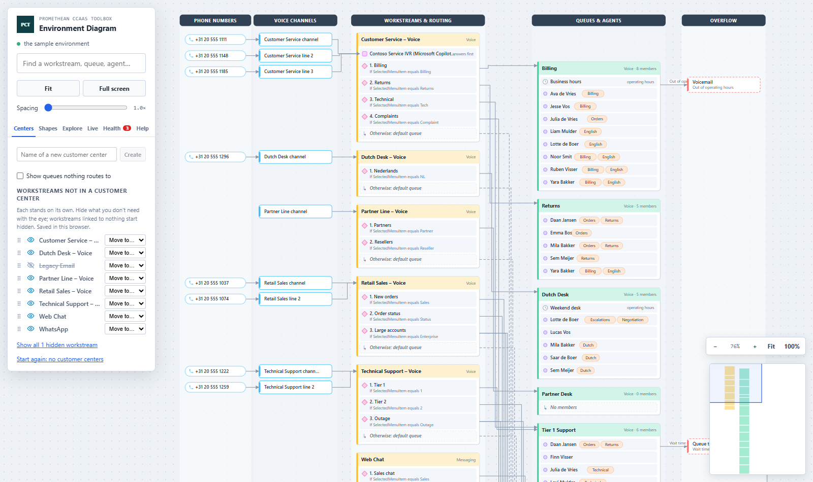
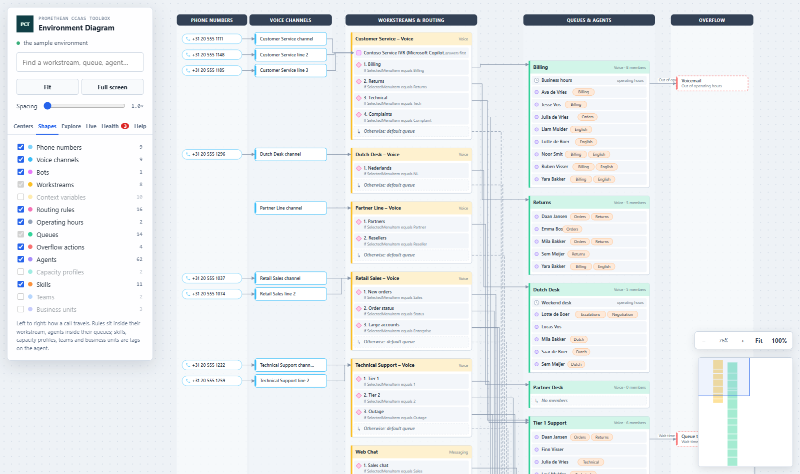
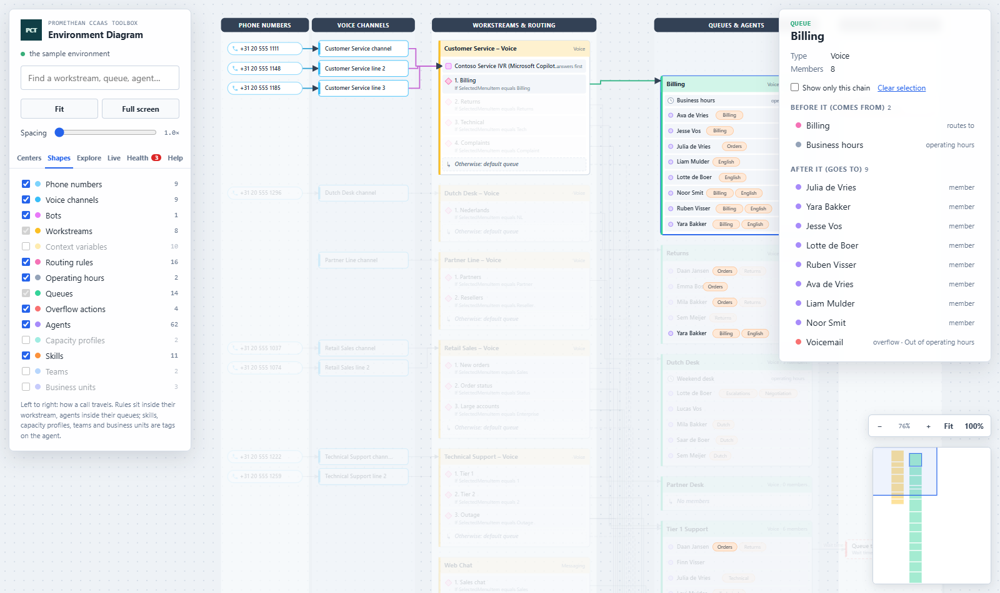
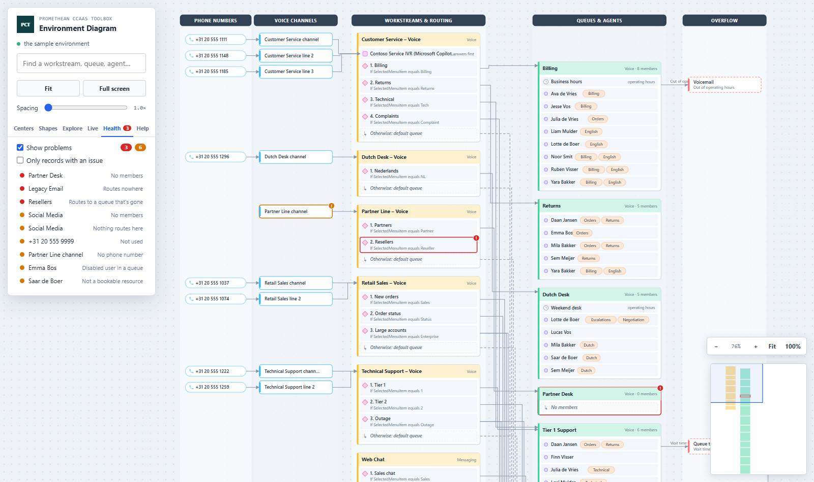
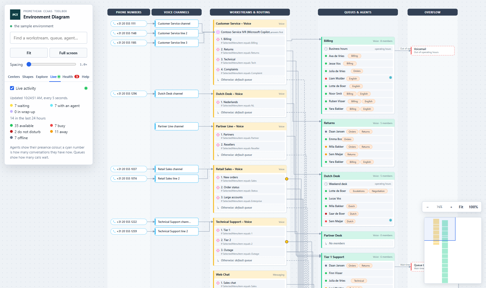
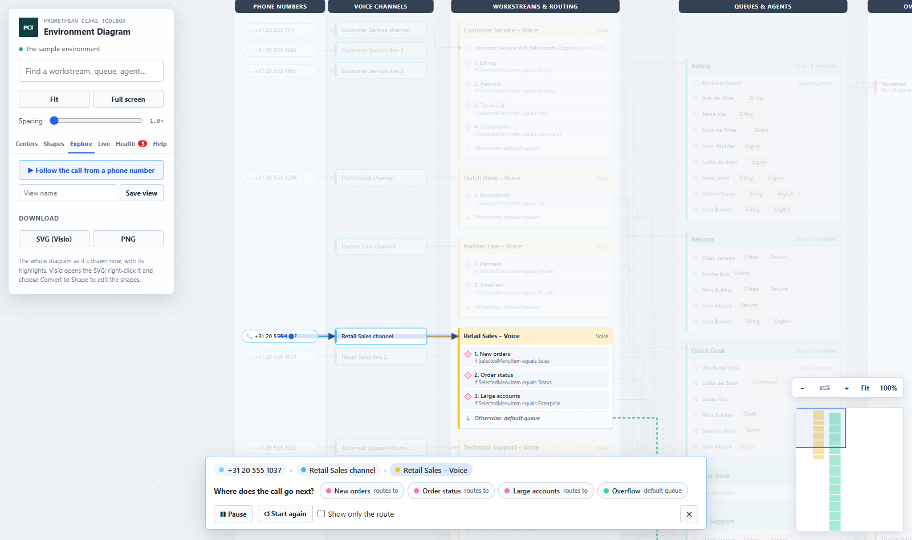
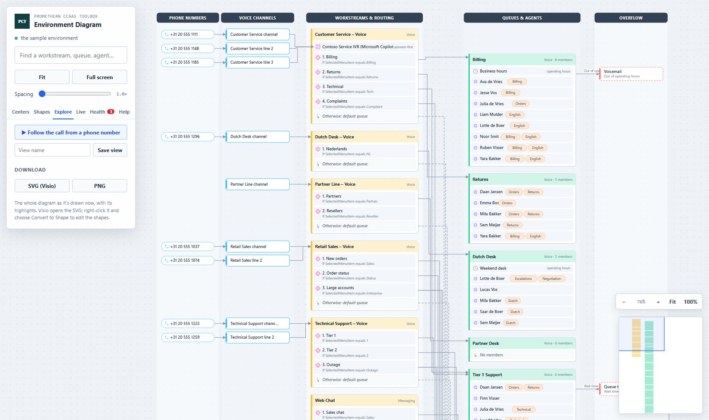

# Environment Diagram — User Manual

The Environment Diagram shows your whole Dynamics 365 Contact Center as one Visio-style diagram, left to right the way a call travels. It only reads: nothing you do here changes the environment. The screenshots use the sample environment that's built into the tool.

## 1. Opening the tool

1. In the Promethean CCaaS Toolbox model-driven app, open **Visualization → Environment Diagram** from the Site Map (or its card on **Toolbox Home**).
2. The tool reads the environment and opens fitted to the width of the screen, at the top. Scroll down for the rest, or click **Fit** to see everything at once.
3. Inside Dataverse it shows your environment. **Use sample data** (under the environment name) switches to the built-in sample, and **Back to live data** returns.

## 2. Reading the diagram

Five swimlanes, left to right:

| Swimlane | What's in it |
| --- | --- |
| Phone numbers | each number, next to the voice channel that uses it |
| Voice channels | each channel, with a line to its workstream (or the workstream's bot) |
| Workstreams & routing | a container per workstream: its bot ("answers first"), its route-to-queue rules in the order they're checked (a diamond, with the condition under the name), and "Otherwise: default queue" |
| Queues & agents | a container per queue: its operating hours and its members; an agent's skills, capacity profiles, teams and business unit are tags on their row |
| Overflow | what happens when a queue overflows, with the trigger on the line (a queue transfer goes on to its queue) |

- A solid line is what a call travels; a dashed line is a workstream's default queue. Percentages on a line are a rule's distribution.
- An agent who is in three queues is drawn in all three.
- Numbers and channels that lead to no workstream are grouped at the bottom left, in **Not connected to a workstream**.
- The **Help** tab has a key to the shapes.

## 3. Moving around

| Do | To |
| --- | --- |
| Drag | move the diagram |
| Scroll | zoom in or out at the pointer |
| **−**, **+**, **Fit**, **100%** (bottom right) | zoom out, zoom in, see everything, actual size |
| Click the minimap | jump there |
| **Spacing** slider | pull the swimlanes further apart |
| **Full screen** (or **F**) | use the whole screen |
| **0** | fit everything |

## 4. Shapes

On the **Shapes** tab, switch kinds of records on and off. Workstreams and queues are always drawn: the diagram is built around them. Context variables, capacity profiles, teams and business units start off. The diagram closes up around what's left.

## 5. Selecting a record

Click any shape. Everything a call passes before and after it lights up; the rest fades. The view doesn't move, so you can click from shape to shape. Every copy of an agent lights up.

The panel on the right shows:
- the record's details (and live figures while live activity is on);
- health findings, with how to fix them;
- for a workstream, its **Customer center**;
- **Show only this chain**: the diagram redraws with just that chain;
- **Open record** (live data only);
- what comes before it and after it; click one to select it.

You can also type a name in the search box at the top; the diagram scrolls to it when it's off screen. **Esc** clears the selection.

## 6. Customer centers

On the **Centers** tab (the tab the tool opens on), group workstreams into customer centers. A customer center is drawn as a dashed container around its workstreams. It's the same tab, and the same saved grouping, as in 3D Contact Center: a center made in either tool shows in both.

- Type a name and click **Create**.
- Drag a workstream onto a center, or use **Move to…**; **Out of this center** takes it out again.
- Click a center's name to go to it; double-click (or **✎**) to rename it; click its colour square to change the colour; **×** deletes the center (its workstreams stay).
- The **eye** hides a workstream from the diagram, with its bot, rules and the channels and numbers that only lead there. Workstreams linked to nothing start hidden. **Show all hidden workstreams** brings them back.
- **Show queues nothing routes to** adds the queues no shown workstream routes to (off at first).
- **Start again: no customer centers** removes all of them.

The grouping is saved in this browser, for this environment.

## 7. Finding problems

On the **Health** tab, tick **Show problems**. Records with a problem get a red mark, warnings an amber one, and the tab lists them; click one to select it and read what's wrong and how to fix it. **Only records with an issue** redraws the diagram with just those records and their direct links.

## 8. Watching live activity

On the **Live** tab, tick **Live activity**. Every 15 seconds (5 in the sample) the tool reads what's happening:
- agents show their presence colour, with a cyan count of the conversations they have now;
- queues show how many calls are waiting;
- workstreams show how many conversations are open;
- new calls run along the line into their queue.

The tab adds up the conversations by state and the agents by presence.

## 9. Following a call, views and downloads

On the **Explore** tab:
- **▶ Follow the call** starts at the selected record (or the first phone number). A dot runs along the lines; where the call can go more than one way, you choose. **Pause**, **Start again**, **Show only the route** and **✕** are in the bar at the bottom.
- **Save view** remembers where you are and how far you zoomed; click a saved view to go back.
- **SVG (Visio)** downloads the whole diagram as a drawing. Open it in Visio (File → Open), then right-click it and choose **Convert to Shape** to edit it. It also opens in a browser or PowerPoint. **PNG** downloads a picture.

## 10. The guided tour

On the **Help** tab, **▶ Play the tour** shows everything the tool can do, step by step, on the sample data. It plays by itself (handy to record a video). Use the bar at the top to pause, go back or forward, or end it. When it ends, the page is put back as it was. Add `?tour=1` to the page address to start it straight away.

## 11. Opening the tool from a link

The page address can ask for:

| Add | To |
| --- | --- |
| `?focus=Billing` | select the record with that name |
| `?health=1` | show problems |
| `?live=1` | switch on live activity |
| `?ride=1` | follow a call (from the record in `focus`, if any) |
| `?tab=centers` (or `shapes`, `explore`, `live`, `health`, `help`) | open on that tab |
| `?depth=2` | spacing between the swimlanes (1 to 3) |
| `?unrouted=1` | show queues nothing routes to |
| `?demo=1` | use the sample data |
| `?tour=1` | play the guided tour |

In a Site Map subarea, put them in the web resource's **Data** field without the `?`, for example `focus=Billing&health=1`.
