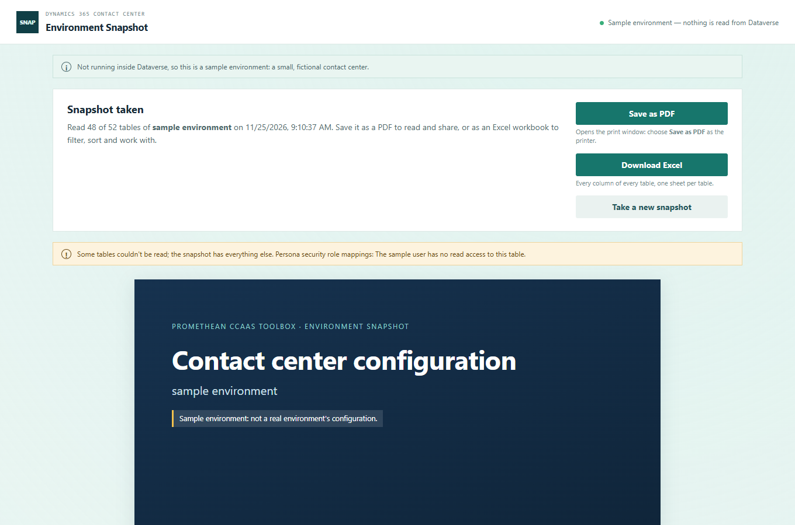

# Environment Snapshot

Part of the [Promethean CCaaS Toolbox](../../Readme.md). A **read-only tool**: it reads the whole contact center configuration of an environment once, and gives it to you in two forms:

- a **PDF document** with a designed layout, to read, share and sign off: workstreams with their channels and routing rules in plain language, queues with their assignment and overflow rules and members, agents, numbers, capacity and skills;
- an **Excel workbook** with every column of every table, to filter, sort and work with.

See the [manual](manual.md) for a walkthrough with screenshots.



## Why

The admin center shows the configuration as separate lists and dialogs. A snapshot puts it in one place, words the routing rules, follows the links (which workstream sends work to which queue, who is a member where), and keeps a dated record: for a go-live, a handover, an audit, or to check what's configured before changing it. To compare two environments (or one environment over time), download a **snapshot file** of each and open them in [Environment Compare](../environment-compare/README.md).

## How it works

1. **Take snapshot.** Every table in the list below is read, with readable labels (a choice's text, a lookup's name). A table that isn't installed is noted as *not in this environment*; one that can't be read is noted with the reason; neither stops the rest.
2. **Preview.** The document is shown on the page, as it prints.
3. **Save as PDF.** Opens the browser's print window: choose **Save as PDF** as the printer. The document prints on A4 pages with a cover, contents, a new page per section and page numbers. The file name offered is `contact-center-snapshot-<environment>-<date><time>`.
4. **Download Excel.** Saves `contact-center-snapshot-<environment>-<date><time>.xlsx`.
5. **Download snapshot file.** Saves `contact-center-snapshot-<environment>-<date><time>.json`: the snapshot as read (secrets already dropped), to compare in [Environment Compare](../environment-compare/README.md). Its format is in `src/snapshotFile.ts` (format name and version, checked when it's loaded).

## What's in a snapshot

| Section | Tables |
| --- | --- |
| Channels and phone numbers | Phone numbers, voice channels, voice channel languages, text-to-speech voices, hold and wait music, chat widgets, SMS, Teams, WhatsApp, Facebook, custom messaging channels and accounts |
| Workstreams | Workstreams (including outbound profiles), context variables, workstream capacity profiles, record routing |
| Routing | Routing configurations and their steps, every ruleset (routing, overflow and assignment rules), overflow actions |
| Queues and assignment | Contact center queues, custom assignment methods and their steps, operating hours, **queue members** |
| Agents, skills and capacity | Bookable resources, agent skills, agent capacity profiles, skills, rating models and values, capacity profiles, users, teams, business units, **team members**, **security roles of agents** |
| Agent experience | Presence, session and notification templates, template parameters, application tab templates, app profiles, productivity pane, persona role mappings, quick replies, tags, audio files, macro action templates, agent scripts |
| Messages and settings | Automated messages, Omnichannel configuration |

**Left out on purpose:**

- **Secrets**, always: any column whose name says key, secret, password, token, connection string and the like (workstreams, for one, carry API keys). They're dropped from the rows the moment they're read, so they're never in a snapshot, a PDF or a workbook. The About sheet and the document's appendix list which columns were left out.
- **Day-to-day data**: conversations, voicemails, recordings. They aren't configuration.
- **Users' personal details**: only the users the configuration points to (queue members, bookable resources, bots) are read, with name, sign-in, business unit, title, status and access mode.
- Helper columns (a lookup's separate name column) and system bookkeeping (row version, import sequence, solution layer).

## The PDF document

| Part | Contents |
| --- | --- |
| Cover | Environment, date and time, who took it, totals |
| Contents | The sections, and any table that couldn't be read |
| 1 Overview | Every workstream (channel, direction, distribution, the queues it sends work to) and every queue (type, assignment method, operating hours, members, used by) |
| 2 Workstreams | Per workstream: its settings, voice channels (number, caller ID, operating hours, transcription and recording, bridged transfer, languages), context variables, capacity profiles and routing rules in plain language |
| 3 Queues | Per queue: its settings, the workstreams that route to it, custom assignment methods with their rules, overflow rules, members |
| 4 Agents | Per agent: queues, skills with rating, capacity profiles, security roles, teams |
| 5 Lists | Phone numbers, capacity profiles, skills, rating models, operating hours, record routing, presence, business units and teams |
| 6 Appendix | Every table read with its row count, and what was left out |

Rules are worded from their definition, for example *When Customer language is "nl-NL" → Route to queue "Sales – NL"*, or for assignment rules *agent's skills matches exactly the conversation's required skills → Pick agents by last assignment time*. Record ids in a rule are replaced by the record's name when the snapshot has it. The rule definitions are read with [Visual Routing Tester](../visual-routing-tester/README.md)'s parser, unchanged.

## The Excel workbook

| Sheet | Contents |
| --- | --- |
| About | Environment, time, user; per table: section, sheet, row count, and notes (scope, why it couldn't be read, secret columns left out) |
| Routing rules | Every rule of every workstream, overflow and assignment ruleset, one row per rule: where, ruleset, order, enabled, when, then |
| Queues | One row per queue: type, assignment method, operating hours, used by, members, custom methods |
| Agents | One row per agent: details, queues, skills, capacity profiles, security roles, teams |
| One sheet per table | Every column, with its display name as the header; a filter on the header and the header frozen |
| Columns | Per sheet and column: the Dataverse table and column name and the column type |

A cell longer than Excel allows (32,767 characters, for a very large ruleset definition) is cut off and says so.

## Permissions and safety

Anyone who can read the configuration tables can take a snapshot; what they can't read is noted, not an error. The tool **only reads**: `src/dataverse.ts` reads rows with `Xrm.WebApi.retrieveMultipleRecords` and table definitions with GET requests, and `tests/readOnly.test.ts` fails if a write appears anywhere in `src/`.

A snapshot contains configuration details and the names of the people in the queues. Treat the PDF and the workbook like any other export of the environment.

## Build, run, deploy

```powershell
npm install
npm test
npm run demo:snapshot   # http://localhost:5455/index.html — sample environment, nothing is read from Dataverse
pwsh ./scripts/deploy.ps1 -Tool snapshot -CreateIfMissing   # first time
pwsh ./scripts/deploy.ps1 -Tool snapshot                    # afterwards
```

Web resources: `pct_/tools/snapshot/{index.html,style.css,bundle.js}`. In the packaged solution from **1.0.0.28** (Site Map: **Tools → Environment Snapshot**). For an environment on an older solution version, add a subarea for `pct_/tools/snapshot/index.html` by hand (see the [toolbox README](../../Readme.md#site-map-subareas)).
