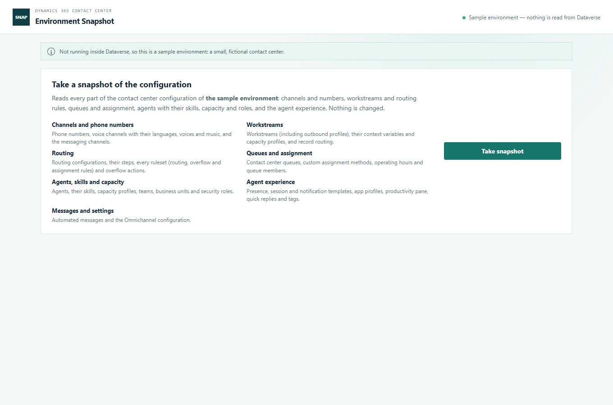
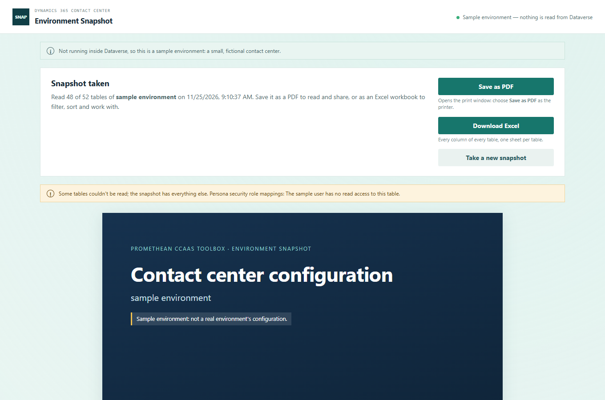
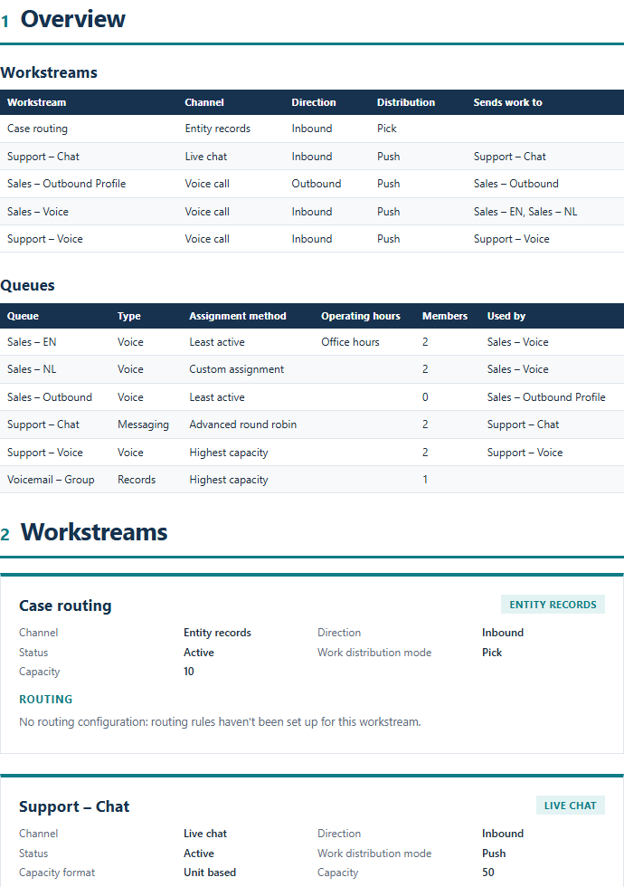
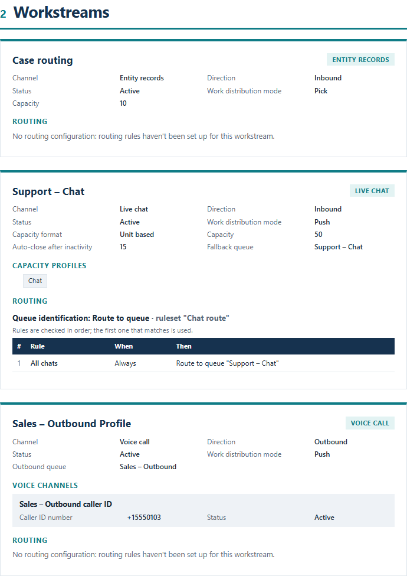
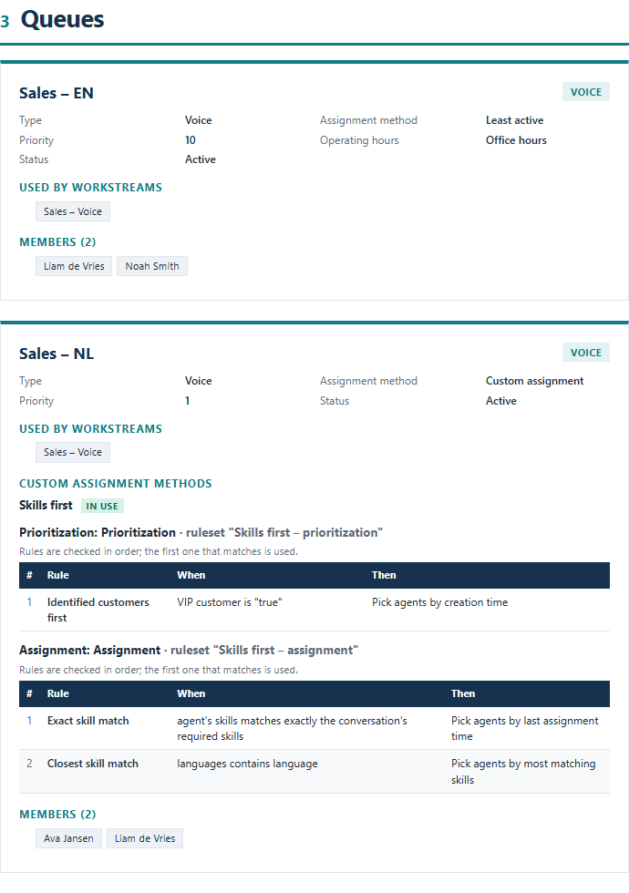

# Environment Snapshot — manual

Take a snapshot of the whole contact center configuration, and save it as a PDF to read and share, or as an Excel workbook to work with. The tool only reads; nothing in the environment changes.

## 1. Take the snapshot

Open **Environment Snapshot** from the Promethean CCaaS Toolbox app. The topbar shows which environment it reads.

The page lists what a snapshot covers. Click **Take snapshot**. A progress bar shows each table as it's read; a large environment takes about half a minute.

## 2. Check the result

When it's done, the page says how many tables were read, and shows the document below it.

- A yellow note lists tables that couldn't be read (for example, no permission). Everything else is in the snapshot; the reason is in the document's contents page and the workbook's About sheet.
- Tables of features that aren't installed (for example WhatsApp) are listed as *not in this environment*. That's not an error.

## 3. Save as PDF

Click **Save as PDF**. The browser's print window opens: choose **Save as PDF** (or *Microsoft Print to PDF*) as the printer and save. Keep *Background graphics* on for the colours of the cover and the tables.

The document has a cover with the totals, a contents page, and then a section per part, each starting on a new page:

Each workstream shows its settings, voice channels, context variables, capacity profiles and routing rules, worded:

Each queue shows its settings, which workstreams send work to it, its custom assignment rules, its overflow rules and its members:

Then the agents (queues, skills, capacity, roles, teams), lists of numbers, capacity profiles, skills, operating hours, presence, business units and teams, and an appendix with every table read.

## 4. Download Excel

Click **Download Excel**. The workbook has:

- **About**: the environment, when and by whom, and every table with its row count and notes;
- **Routing rules**, **Queues** and **Agents**: the overviews from the document, one row per rule, queue or agent;
- one sheet per table, with every column (filter and sort with the header row);
- **Columns**: the Dataverse name of every column, for when you need to look one up.

## 5. Download the snapshot file

Click **Download snapshot file** to save the snapshot as a `.json` file. Open it in **Environment Compare** to compare this environment with another one, or with a later snapshot of itself.

## Good to know

- Secrets (keys, passwords, tokens) are never in a snapshot. The appendix and the About sheet name the columns left out.
- Only work details of users are included: name, sign-in, business unit, title, status.
- Take a new snapshot any time with **Take a new snapshot**; each one is dated.
- Outside the app the tool can't reach Dataverse and shows a sample environment instead.
