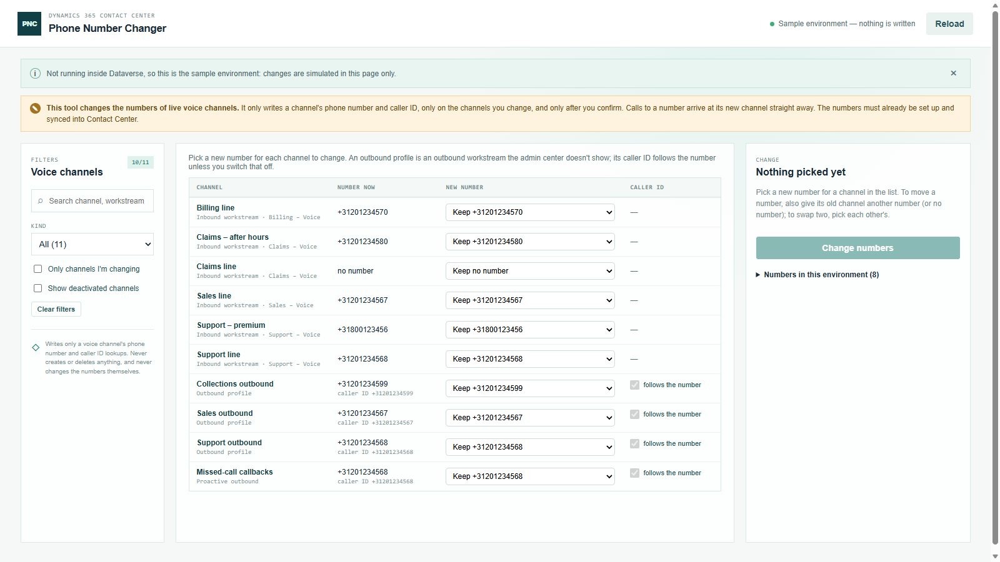

# Phone Number Changer

Part of the [Promethean CCaaS Toolbox](../../Readme.md). A **provisioning tool** that changes which phone number a voice channel uses: the number customers call on an inbound workstream, and the number (and caller ID) an outbound profile calls out with. Move a number from one workstream or profile to another, swap two, or give a channel a new number, in one go, with a preview, a confirmation and a revert.

It's the Contact Center step of replacing a number, as described in [Replacing a phone number in a Dynamics 365 Contact Center voice channel that is bound to a workstream](https://promethean.academy/replacing-a-phone-number-in-a-dynamics-365-contact-center-voice-channel-that-is-bound-to-a-workstream/). The number must already be set up in Teams and **synced into Contact Center**; the tool doesn't do the Teams side.

See the [manual](manual.md) for a walkthrough, and [IMPLEMENTATION_STATUS.md](IMPLEMENTATION_STATUS.md) for the schema checks and status.

## What it lists

Every voice channel (`msdyn_ocvoicechannelsetting`), with what its workstream is used for (from `msdyn_direction`):

| Kind | What it is |
| --- | --- |
| Inbound workstream | A voice channel of an inbound workstream: the number customers call. |
| Outbound profile | An outbound profile. Under the hood it's an outbound workstream with one voice channel, which the admin center doesn't show as a workstream. It has a number and a caller ID. |
| Proactive outbound | A proactive outbound workstream, for example for missed-call callbacks. Also a number and a caller ID. |

## How it works

1. **Pick new numbers.** For each channel to change, pick a new number (or **No number**). The list only offers active numbers that are enabled for the channel's direction (inbound for an inbound workstream, outbound for an outbound profile); others are shown but can't be picked. Each number says whether it's free or how many channels use it. On an outbound profile the **caller ID follows the number**, unless you switch that off.
2. **Check.** The panel lists every change. Problems block the change and show in red on the row:
   - the number isn't active, or isn't enabled for the direction;
   - the number would answer on **two inbound channels**: a call can only arrive in one place, so give the other channel another number in the same change (that's a move), or pick each other's (a swap).

   A number shared with outbound profiles, a channel left without a number, or a deactivated channel give a warning but don't block.
3. **Change.** After a confirmation naming the environment, the channels are updated one at a time in a safe order: a channel giving its number away is updated before the one taking it, and in a swap one channel's number is freed first. Before an inbound channel takes a number the tool checks no other inbound channel still has it; if one does (because its update failed), that change is skipped instead of putting the number on two channels. Then every channel is read back to confirm.
4. **Review, log and revert.** The result shows what changed, what didn't and why. **Download log** saves the run; **Revert this change** puts the previous numbers back, in the same safe order.

Calls to a number arrive at its new channel straight away.

## Tables read and written

| Table | Read | Written |
| --- | --- | --- |
| `msdyn_ocvoicechannelsetting` | name, state, workstream, `msdyn_phonenumberid`, `msdyn_calleridphonenumberid` | **only** `msdyn_phonenumberid` and `msdyn_calleridphonenumberid` (update; bound to a number, or cleared) |
| `msdyn_liveworkstream` | name, `msdyn_direction` | — |
| `msdyn_ocphonenumber` | number, state, `msdyn_phoneinboundenabled`, `msdyn_phoneoutboundenabled` | — |

It never creates or deletes anything, and never changes the phone numbers themselves. `tests/writeScope.test.ts` checks this, and `src/dataverse.ts` refuses any other column at run time. The platform's own plug-in on voice channel updates (`PostOperationVoiceChannelSettingEventPlugin`) runs as it does when the admin center changes a number.

## Run log

**Download log** saves a CSV of the run: tool, environment, user, start and finish time, and per channel its kind, workstream, number and caller ID before and after, what was read back, the status, time and any error.

## Build, run, deploy

- Demo with sample data: `npm run demo:numberchanger` → http://localhost:5450/index.html (outside Dataverse the tool always uses the sample, and writes nothing).
- Tests: `npx jest tools/phone-number-changer`
- Deploy: `pwsh ./scripts/deploy.ps1 -Tool numberchanger` (add `-CreateIfMissing` the first time in an environment).
- Web resources: `pct_/tools/numberchanger/{index.html,style.css,bundle.js}`. Not in the packaged solution yet: add a Site Map subarea of type Web Resource for `pct_/tools/numberchanger/index.html` (suggested: **Provisioning → Phone Number Changer**).
