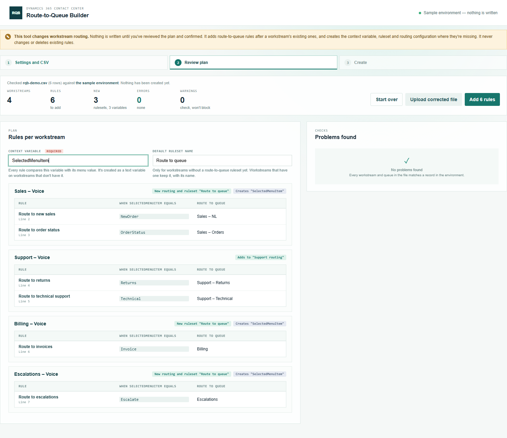

# Route-to-Queue Builder

Part of the [Promethean CCaaS Toolbox](../../Readme.md). A **creation tool**: it adds route-to-queue rules to workstreams in bulk from a CSV file. Each rule routes a conversation to a queue when a context variable equals a value, for example the menu option a caller chose in the IVR.

> **Tested live in one environment so far** (adding to an existing ruleset, creating routing and a ruleset, creating the context variable). Routing a real call through the new rules hasn't been tested; see [IMPLEMENTATION_STATUS.md](IMPLEMENTATION_STATUS.md#live-findings-2026-10-14).

See the [manual](manual.md) for a walkthrough with screenshots.



## How it works

1. **Settings.** Enter the **context variable** every rule compares (e.g. `SelectedMenuItem`) and a **default ruleset name** for workstreams that don't have route-to-queue rules yet.
2. **Upload the CSV.** One row per rule.
3. **Review.** Rules are grouped per workstream, with what will happen to each: rules added to its existing ruleset, or a new ruleset (and routing) created; and whether the context variable is created. Problems are listed per line. The settings can still be changed here.
4. **Create.** After a confirmation naming the environment, each workstream is done in turn and read back.
5. **Log.** The result per workstream, and a CSV log of every record created or changed.

## CSV

| Column | Required | Meaning |
| --- | --- | --- |
| `workstream_name` | Yes | The workstream whose route-to-queue rules get this rule. |
| `rule_name` | Yes | The rule's name. Unique within the workstream's ruleset. |
| `menu_value` | Yes | The value the context variable must equal. Compared as text, exactly. |
| `queue_name` | Yes | The advanced queue the conversation is routed to. |

```csv
workstream_name,rule_name,menu_value,queue_name
WS1,Route to service,Service,Service Queue
WS1,Route to sales,Sales,Sales Queue
WS2,Route to claims,Claims,Claims Queue
```

Every rule is: *context variable* **equals** `menu_value` → route to `queue_name`.

## Per workstream

| The workstream has… | The tool… |
| --- | --- |
| No context variable with that name | Creates it as a text variable, then waits until the platform has added it to the workstream's routing (up to 2 minutes). |
| A route-to-queue ruleset | Adds the rules after the existing ones, in the order of the file. The ruleset keeps its name. |
| Routing, but no route-to-queue ruleset | Creates a ruleset with the default name and adds it to the routing. |
| No routing at all | Creates the routing configuration and the ruleset, both with the default name. |

A workstream has only one route-to-queue ruleset, so all rows of one workstream go into the same ruleset.

## Checks

| Problem | Result |
| --- | --- |
| No context variable entered, or not a plain name (letters, digits, underscores) | Error |
| A missing column, an empty cell | Error |
| Workstream or queue not found, or more than one with that name | Error |
| Workstream without a routing contract, or with routing that isn't active | Error |
| The variable exists on the workstream with another type, or in another case | Error |
| A rule name that's already in the ruleset or in the file | Error |
| A voice queue for a non-voice workstream, or the other way round | Error |
| No default ruleset name, for a workstream that needs a new ruleset | Error |
| A value that another rule already routes | Warning |

## Failures

- One workstream failing doesn't stop the others.
- If the platform hasn't added a new context variable to the routing in time, no rules are written for that workstream. Upload the file again a minute later: the variable then exists and is used.
- A run that stops part-way lists what was created. Uploading the file again picks up from there (an existing routing configuration is reused).

## Permissions and safety

The person using it is expected to be a **system administrator**.

- **Creates**: `msdyn_ocliveworkstreamcontextvariable`, `msdyn_routingconfiguration`, `msdyn_decisionruleset`, `msdyn_routingconfigurationstep`.
- **Updates**: only `msdyn_rulesetdefinition` on a route-to-queue ruleset, to add rules after the existing ones.
- **Never deletes**, never changes existing rules, and never writes a workstream, a queue or a decision contract. The platform updates the routing contract itself.
- All writes are in `src/dataverse.ts`, which refuses any table or column outside `CREATE_COLUMNS` and `UPDATE_COLUMNS` in `src/schema.ts`. They go straight to the Web API as POST and PATCH requests. `tests/writeScope.test.ts` pins the column lists and fails if a delete, `execute` or an `Xrm.WebApi` write appears in `src/`, or if the Web API is called from another file.
- New conversations are routed by the new rules straight away.

## Tables read

`msdyn_liveworkstream`, `msdyn_ocliveworkstreamcontextvariable`, `msdyn_routingconfiguration`, `msdyn_routingconfigurationstep`, `msdyn_decisionruleset`, `msdyn_decisioncontract` (the shared output contract, and the routing contract while waiting for a new variable), `queue` (active advanced queues).

## Build, run, deploy

```powershell
npm install
npm test
npm run demo:routetoqueuebuilder   # http://localhost:5446/index.html — sample environment, nothing is written
pwsh ./scripts/deploy.ps1 -Tool routetoqueuebuilder -CreateIfMissing   # first time
pwsh ./scripts/deploy.ps1 -Tool routetoqueuebuilder                    # afterwards
```

Web resources: `pct_/tools/routetoqueuebuilder/{index.html,style.css,bundle.js}`. In the packaged solution from **1.0.0.10** (Site Map: **Creation → Route-to-Queue Builder**). For an environment on an older solution version, add a subarea for `pct_/tools/routetoqueuebuilder/index.html` by hand (see the [toolbox README](../../Readme.md#site-map-subareas)).
