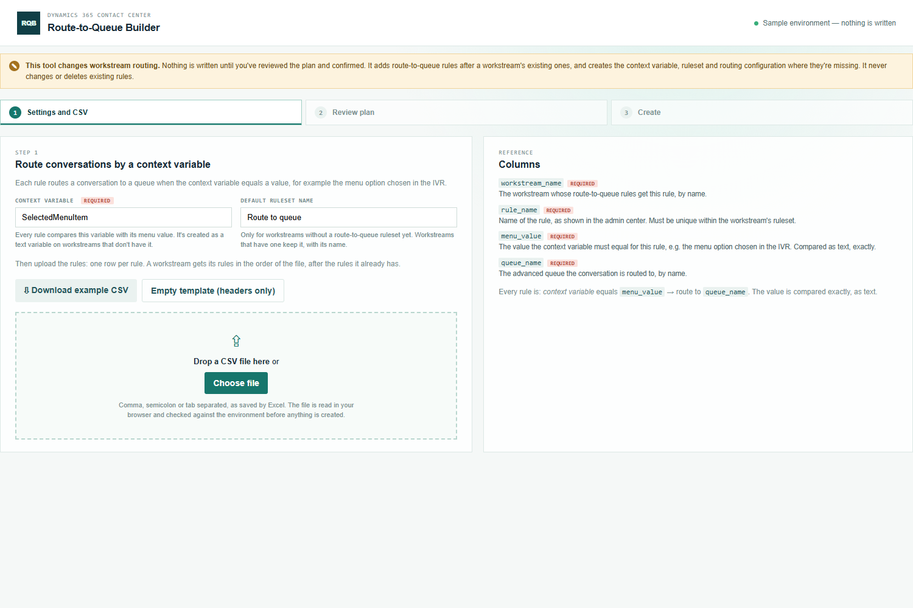
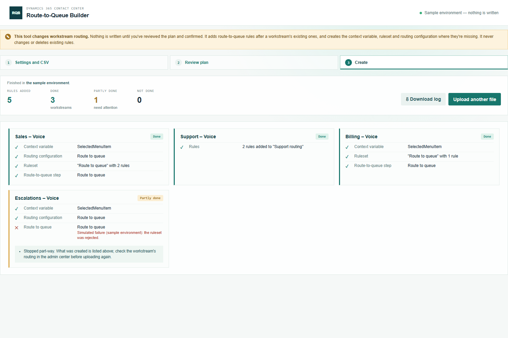

# Route-to-Queue Builder — manual

Add route-to-queue rules to many workstreams at once: each rule routes a conversation to a queue when a context variable (for example the menu option chosen in the IVR) equals a value.

## 1. Settings and CSV

Open **Route-to-Queue Builder** (under **Creation**) from the Promethean CCaaS Toolbox app. The topbar shows which environment it changes.

- **Context variable**: the variable every rule compares, e.g. `SelectedMenuItem`. Enter it exactly as it's named on the workstreams (names are case-sensitive). Workstreams that don't have it get it as a text variable.
- **Default ruleset name**: used only for workstreams without route-to-queue rules yet. A workstream that has a ruleset keeps it, with its name.

Then prepare the CSV: one row per rule, with `workstream_name`, `rule_name`, `menu_value` and `queue_name`. **Download example CSV** gives a starting point. Drop the file on the page or click **Choose file**.

## 2. Review

The plan shows each workstream with its rules in the order they'll be added, and what happens to the workstream:

- **Adds to "…"**: the rules go after the workstream's existing route-to-queue rules.
- **New ruleset "…"**: the workstream has routing, but no route-to-queue rules yet.
- **New routing and ruleset "…"**: the workstream has no routing yet.
- **Creates "…"**: the context variable is created on the workstream.

**Problems found** lists errors (fix them first) and warnings (check them; they don't block). You can still change the context variable and the default ruleset name here; the plan updates straight away. After fixing the file, click **Upload corrected file**.

## 3. Create

Click **Add N rules** and confirm. Each workstream is done in turn. Creating a context variable takes the platform up to a minute, so keep the page open.

Each workstream shows what was created or changed:

- **Done**: all its rules were added and read back.
- **Partly done**: something was created, but not everything. The card says what to do. For a new context variable that the platform hadn't processed in time: upload the same file again a minute later.
- **Not done**: nothing was written for that workstream.

**Download log** saves a CSV of the run with every record created or changed.

## Good to know

- Rules are only ever added. To change or remove a rule, use the admin center.
- Every rule is "equals", compared exactly as text: `Sales` doesn't match `sales` or `Sales `.
- Two rules with the same value both match. The review warns about it.
- Outside the app the tool can't reach Dataverse and shows a sample environment instead; nothing is written there.
