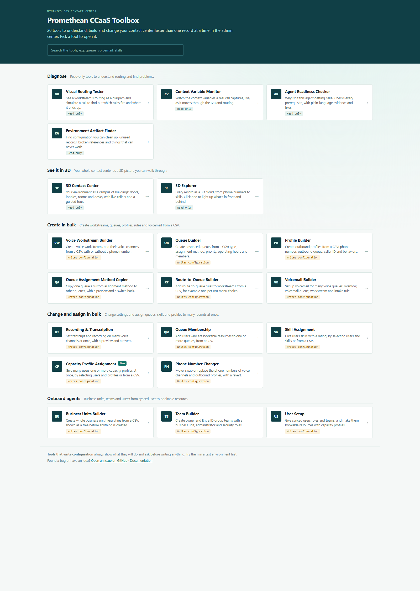

# Toolbox Home

Part of the [Promethean CCaaS Toolbox](../../Readme.md). The toolbox's landing page. It shows every tool as a card, grouped as in the app's Site Map, with a short description and a "Read-only" or "Writes configuration" tag. A search box filters the cards.



## How it works

- **A click opens the tool inside the app**, in the main area next to the left menu (`Xrm.Navigation.navigateTo` with the tool's web resource).
- **A middle click or Ctrl+click** opens the tool's page in a new browser tab.
- **Outside the app**, for example in the local demo, a card is a plain link to the tool's page.
- **It doesn't touch Dataverse.** The page reads and writes nothing; a test checks this.

## Keeping it up to date

The cards come from [src/tools.ts](src/tools.ts). A test (`tests/home.test.ts`) fails when a tool is in `deploy.config.json` but not on the home page, or the other way round. When you add a tool, add its card there: name, group, one-line description, and whether it writes configuration.

## Site Map

Add it as the **first subarea** of the app, so the app opens on it:

- **Type:** Web Resource
- **Web resource:** `pct_/tools/home/index.html`
- **Title:** Home (or Toolbox Home)

## Build, run, deploy

```powershell
npm run demo:home   # http://localhost:5452/home/index.html (served from dist/webresource so the card links work)
pwsh ./scripts/deploy.ps1 -Tool home -CreateIfMissing   # first time
pwsh ./scripts/deploy.ps1 -Tool home                    # afterwards
```

Web resources: `pct_/tools/home/{index.html,style.css,bundle.js}`. In the packaged solution from **1.0.0.18** as the first subarea: **Home → Toolbox Home**.
