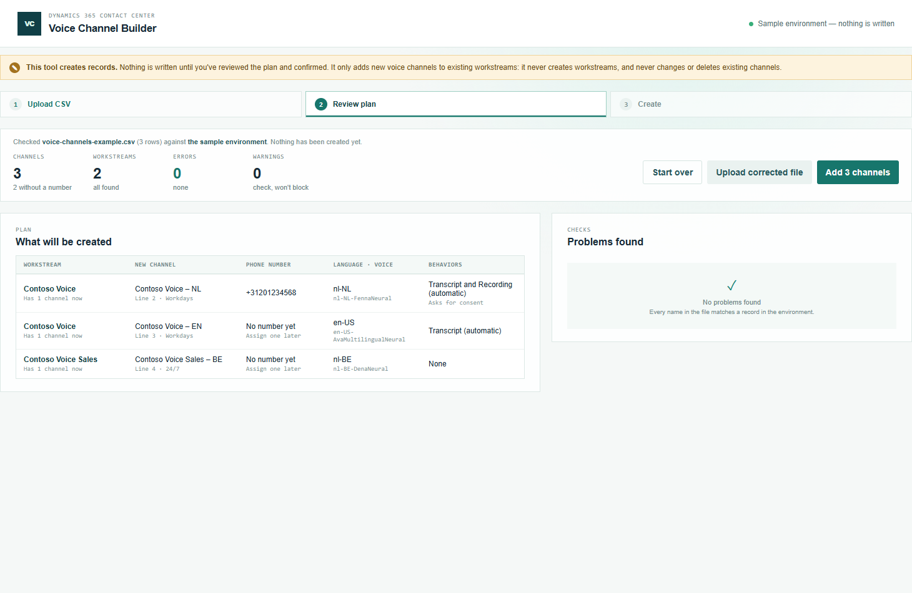

# Voice Channel Builder

Part of the [Promethean CCaaS Toolbox](../../Readme.md). A **creation tool**: it adds **voice channels to existing voice workstreams** in bulk from a CSV file, each **with or without a phone number**, instead of adding them one by one in the Copilot Service admin center. To create new workstreams with their channels, use [Voice Workstream Builder](../voice-workstream-builder/README.md).

See the [manual](manual.md) for a walkthrough with screenshots.



## How it works

1. **Upload.** Click **Download example CSV**, adapt it in Excel, and upload it. The same example is in the repo as [`examples/voice-channels-example.csv`](examples/voice-channels-example.csv); a test keeps the two identical.
2. **Review.** Every row is checked, then every name is matched against the environment: the workstream must exist and be an active inbound voice workstream. **Nothing is written in this step.** Errors block creation; warnings don't.
3. **Create.** After a confirmation that names the environment, each channel is created with its language setting (and text-to-speech voice), and reported with its records, ids and (live) links.
4. **Log.** **Download log** saves the run as a CSV, in the same layout as the other creation tools.

## The CSV

One row per new voice channel. `workstream_name` names the existing workstream; rows with the same workstream add several channels to it. Every other column is exactly a [Voice Workstream Builder channel column](../voice-workstream-builder/README.md), with the same defaults and checks, so channel rows can be copied between the two files.

| Column | Empty means | Notes |
| --- | --- | --- |
| `workstream_name` | **Required** | An existing, active **inbound voice** workstream. Matched case-insensitively. |
| `channel_name` | **Required** | Unique in the file. A name that already exists in the environment is a warning. |
| `phone_number` | No number | E.164. Must exist and be active. Empty creates the channel without a number, to assign later (for example with Phone Number Changer). |
| `language` | **Required** | Locale code, e.g. en-US. |
| `tts_voice`, `voice_style`, `voice_speed`, `voice_pitch` | No voice / normal | An empty voice is a warning: prompts have no voice until one is set. |
| `hold_music`, `wait_music` | Not set | e.g. Transform. |
| `operating_hours` | Always open | Operating hours record name. |
| `transcript_recording`, `transcript_recording_start` | None, Automatic | |
| `agent_transcription_controls`, `agent_recording_controls` | Yes | |
| `request_recording_consent`, `stop_recording_on_hold`, `play_recording_notifications`, `show_transcript_by_default` | No | |
| `pstn_transfer_controls`, `teams_transfer_controls` | Yes | |
| `bridged_transfer_pstn`, `bridged_transfer_teams` | No | Bridged transfer to an external phone number (PSTN) or Teams user: the original call stays up and the external party sees your number. Yes only has an effect when the matching transfer controls are Yes (a warning otherwise). |

### Checks

| Check | Severity |
| --- | --- |
| Missing `workstream_name` or `channel_name` column, empty file, a column listed twice | Error |
| Empty `workstream_name`, `channel_name` or `language`; duplicate channel name in the file | Error |
| Workstream not found, or two workstreams with that name | Error |
| Workstream isn't voice, is deactivated, or is an outbound profile (or another non-inbound direction) | Error |
| Phone number not E.164, not found or deactivated | Error |
| Language, music or operating hours not found, or ambiguous | Error |
| Phone number not enabled for inbound calling, already used by another channel, or used twice in the file | Warning |
| Channel name already exists in the environment; no text-to-speech voice; voice doesn't match the language | Warning |
| Unknown column (ignored) | Warning |

## What gets written

The same records Voice Workstream Builder creates for a channel, with the same verified schema and payloads:

| Record | Table | Notes |
| --- | --- | --- |
| Voice channel | `msdyn_ocvoicechannelsetting` | Linked to the existing workstream (`msdyn_liveworkstreamid`); phone number, operating hours, transcript/recording and transfer controls. |
| Text-to-speech voice | `msdyn_ocvoice` | Only when `tts_voice` is set; one per channel, as the admin center does. |
| Channel language | `msdyn_ocvoicechannellanguagesetting` | Primary language, voice and music. |

The workstream itself isn't changed. Because it already exists, there's no "set up routing rules" note: calls on the new channel follow the workstream's existing routing.

## Permissions and safety

Meant for **system administrators**. The tool has no Dataverse code of its own: every write goes through Voice Workstream Builder's `dataverse.ts`, which only creates, and only voice records. On top of that, the tool runs its plan through `addChannels`, which refuses to start unless every workstream in it already exists, so it can never create a workstream or capacity link. `tests/writeScope.test.ts` fails if any Dataverse call appears in this tool's `src/`, or if the app bypasses `addChannels`; `tests/plan.test.ts` checks that only channel records are created.

## Build, run, deploy

```powershell
npm test
npm run demo:channelbuilder   # http://localhost:5454/index.html — sample environment, nothing is written
pwsh ./scripts/deploy.ps1 -Tool channelbuilder
```

Site Map subarea: Type Web Resource, `pct_/tools/channelbuilder/index.html`, in the **Creation** group. Included in solution 1.0.0.21 onward (`power_platform_solution/PrometheanCCaaSToolbox_1_0_0_23.zip`); the deploy script doesn't change the Site Map.

See [IMPLEMENTATION_STATUS.md](IMPLEMENTATION_STATUS.md) for decisions and what's been tested.
