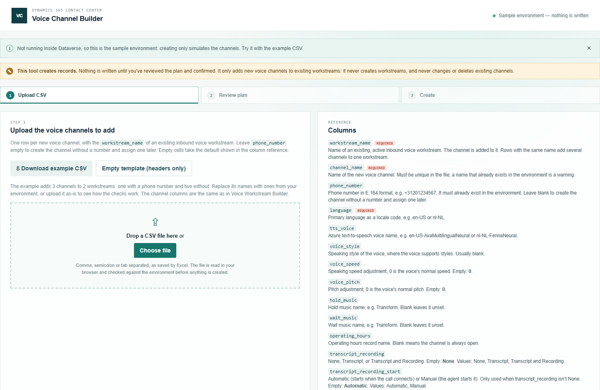
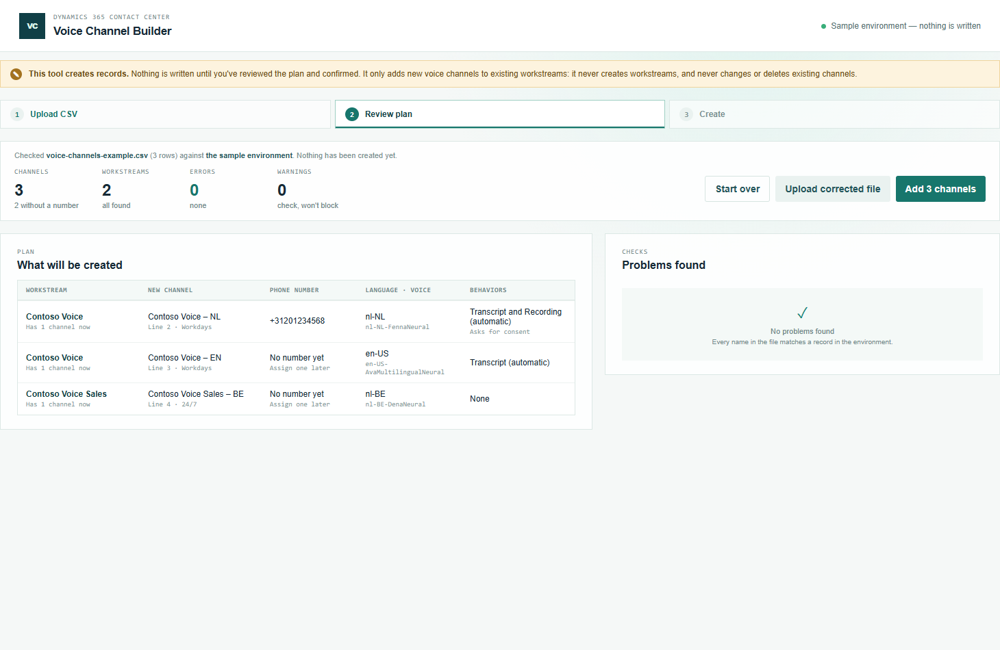
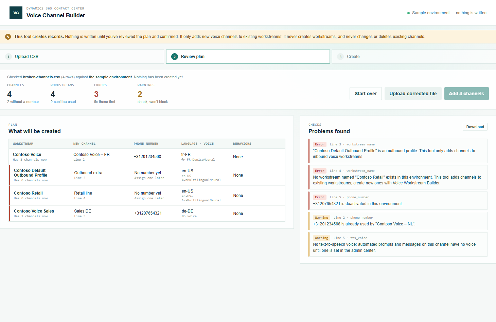
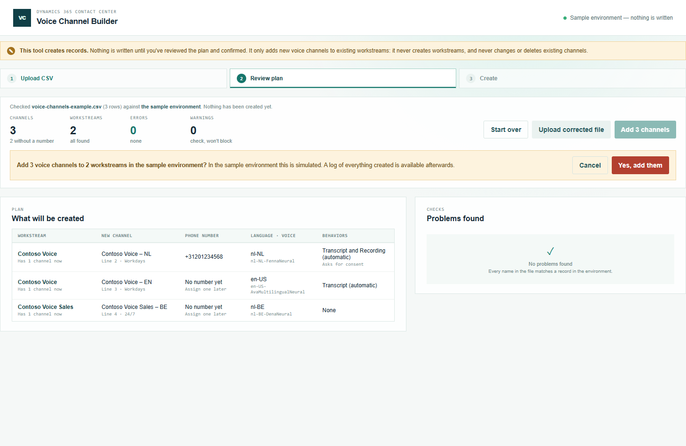
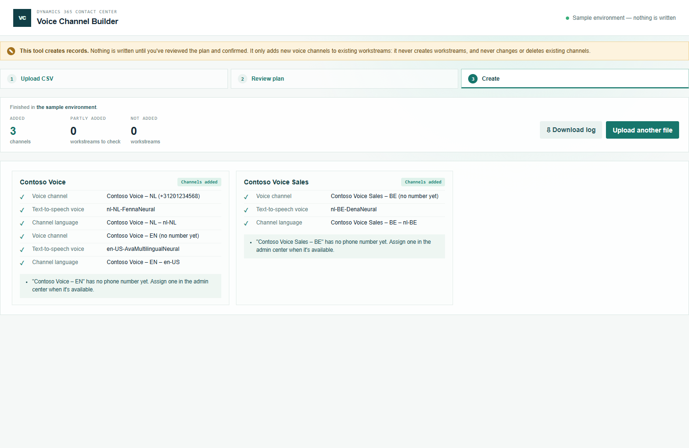

# Voice Channel Builder — User Manual

Voice Channel Builder adds voice channels to voice workstreams that already exist, with or without a phone number. You describe the channels in a CSV file, check them, and create them in one go. The screenshots use the sample environment that's built into the tool.

To create new workstreams with their channels, use [Voice Workstream Builder](../voice-workstream-builder/manual.md) instead.

## 1. Opening the tool

1. In the Promethean CCaaS Toolbox model-driven app, open **Creation → Voice Channel Builder** from the Site Map (or its card on **Toolbox Home**).
2. Inside Dataverse, the topbar says **Creates in** with your environment. Outside it, the tool uses the sample environment and nothing is written.

## 2. Preparing the CSV

1. Click **Download example CSV** and open it in Excel. **Empty template** gives just the column headers.
2. Add one row per new channel:
   - `workstream_name`: an existing, active inbound voice workstream. Several rows with the same workstream add several channels to it.
   - `channel_name` and `language` (a locale code such as `nl-NL`) are required.
   - `phone_number` is optional. Leave it empty to create the channel without a number and assign one later.
3. The **Columns** list on the right explains every column and what an empty cell means. The channel columns are the same as in Voice Workstream Builder.
4. Save the file as CSV. Comma, semicolon or tab separated all work.

### What happens when you leave a cell empty

| Column | Empty means |
| --- | --- |
| `workstream_name`, `channel_name`, `language` | Not allowed: the row is reported as an error |
| `phone_number` | The channel is created without a number |
| `tts_voice` | No voice (a warning): prompts have no voice until one is set |
| `hold_music`, `wait_music` | Not set |
| `operating_hours` | Always open |
| `transcript_recording` | None |
| `transcript_recording_start` | Automatic |
| `agent_transcription_controls`, `agent_recording_controls`, `pstn_transfer_controls`, `teams_transfer_controls` | Yes |
| `bridged_transfer_pstn`, `bridged_transfer_teams` | No |
| `request_recording_consent`, `stop_recording_on_hold`, `play_recording_notifications`, `show_transcript_by_default` | No |
| `voice_speed`, `voice_pitch` | 0 (normal) |

## 3. Uploading and reviewing

1. Drop the file on the page, or click **Choose file**.
2. The tool checks every row and matches every name against the environment. Nothing is written yet.
3. **What will be created** lists each new channel with its workstream (and how many channels that workstream has now), number, language, voice and behaviors.

4. **Problems found** lists errors and warnings by line and column. Errors block creation; warnings don't. Common errors: the workstream doesn't exist, is an outbound profile, isn't a voice workstream, or is deactivated; a number that doesn't exist or is deactivated.
5. Fix the file and click **Upload corrected file**, or **Download** the list of problems.

## 4. Creating the channels

1. Click **Add N channels**. A confirmation names the environment and the numbers of channels and workstreams.
2. Click **Yes, add them**. Keep the page open until it's finished.

3. Each workstream gets a card listing its new records: the voice channel, its text-to-speech voice and its channel language, each with a link in the live environment.
4. A channel without a number gets a note: assign a number in the admin center, or with **Phone Number Changer**.
5. If a record fails, that workstream stops there; the records marked Created exist. The other workstreams carry on. Nothing is deleted automatically.

6. **Download log** saves a CSV with every record, its id and time, the notes and the warnings you accepted.
