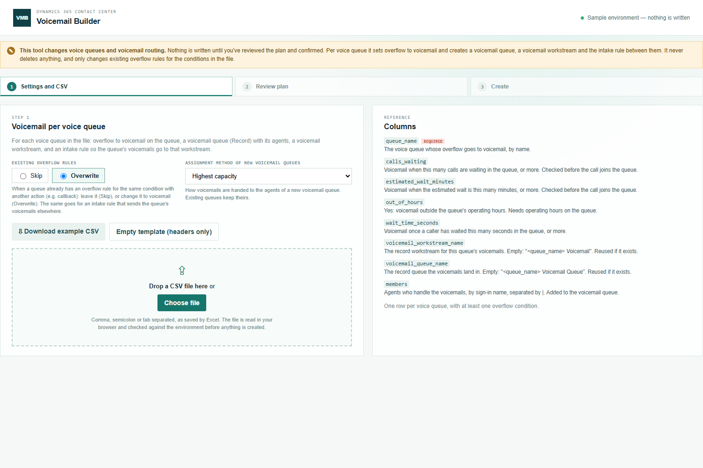
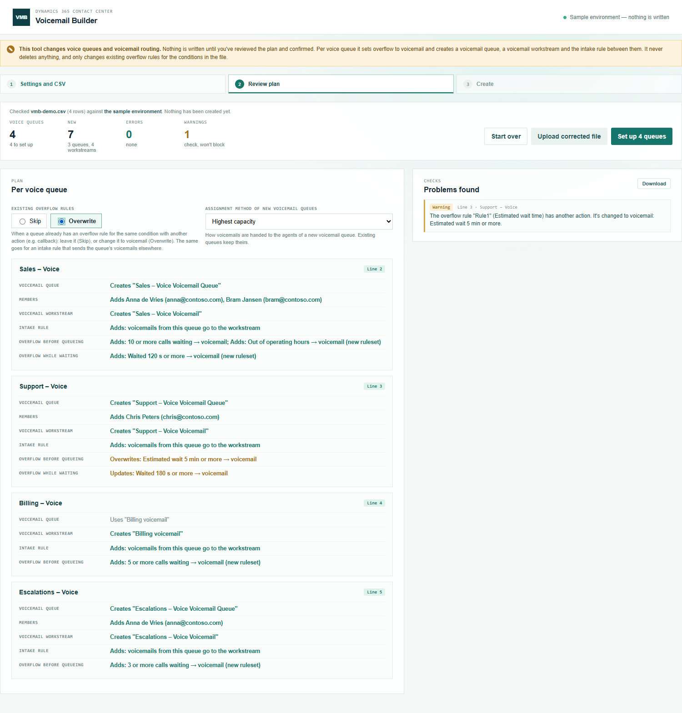
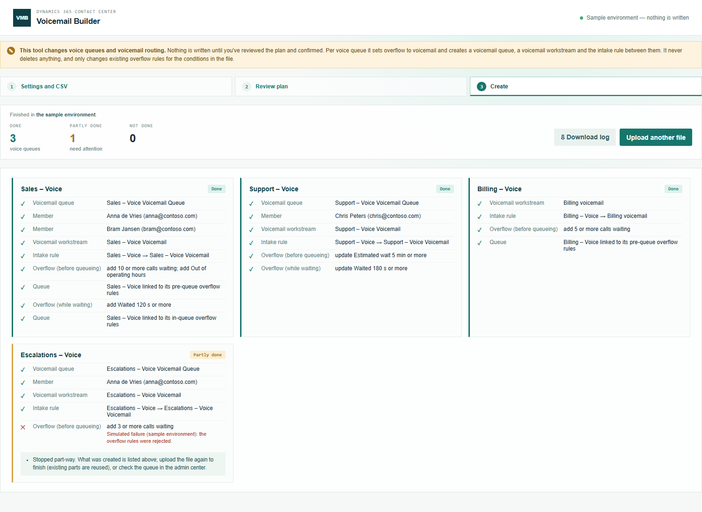

# Voicemail Builder — manual

Set up voicemail for many voice queues at once, each with its own voicemail queue.

Before you start, check that call recording and voicemail are available in your Contact Center, and that the voice workstreams have no operating hours of their own: with operating hours on the workstream, callers outside those hours hear the closed message instead of being offered voicemail.

## 1. Settings and CSV

Open **Voicemail Builder** (under **Creation**) from the Promethean CCaaS Toolbox app. The topbar shows which environment it changes.

- **Existing overflow rules**: when a queue already has an overflow rule for the same condition with another action (for example a callback), **Skip** leaves it as it is and **Overwrite** changes it to voicemail.
- **Assignment method of new voicemail queues**: how voicemails are handed to the agents.

Prepare the CSV: one row per voice queue, with at least one overflow condition (`calls_waiting`, `estimated_wait_minutes`, `out_of_hours`, `wait_time_seconds`) and the agents who handle the voicemails in `members`. **Download example CSV** gives a starting point. Drop the file on the page or click **Choose file**.

## 2. Review

Each voice queue shows what will happen:

- **Voicemail queue / Voicemail workstream**: *Creates* a new one, or *Uses* an existing one with that name.
- **Members**: the agents added to the voicemail queue.
- **Intake rule**: *Adds* the rule that sends this queue's voicemails to its workstream, or says it's already in place.
- **Overflow before queueing / while waiting**: each rule that's added, updated (new threshold) or overwritten (other action changed to voicemail), and any that are skipped.

**Problems found** lists errors (fix them first) and warnings (check them; they don't block). You can still switch between Skip and Overwrite here; the plan updates straight away.

## 3. Create

Click **Set up N queues** and confirm. Each queue is done in turn.

- **Done**: everything for that queue is in place and read back.
- **Partly done**: it stopped part-way; the card lists what was created. Overflow on that queue isn't switched on. Upload the same file again to finish: what already exists is reused.
- **Not done**: nothing was created for that queue.

**Download log** saves a CSV of the run with every record created or changed.

## Good to know

- Test with one queue first: let a call overflow, leave a voicemail, and check it arrives in that queue's voicemail queue.
- Nothing is ever deleted. To undo, change the queue's overflow, the voicemail intake rules or the voicemail workstream in the admin center.
- Outside the app the tool can't reach Dataverse and shows a sample environment instead; nothing is written there.
